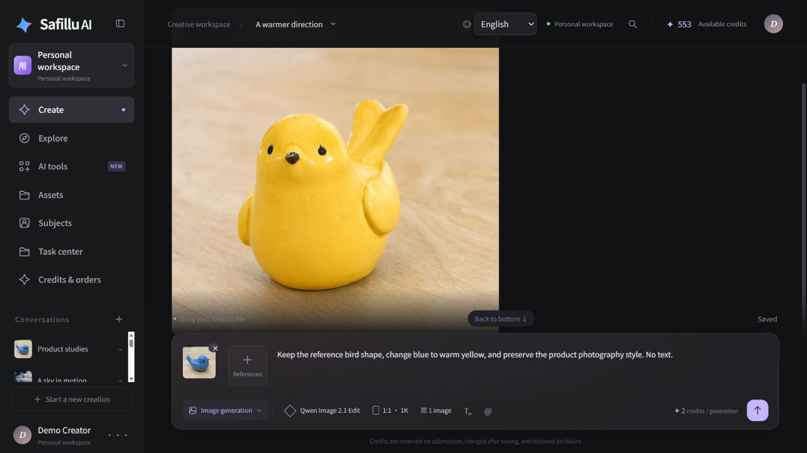
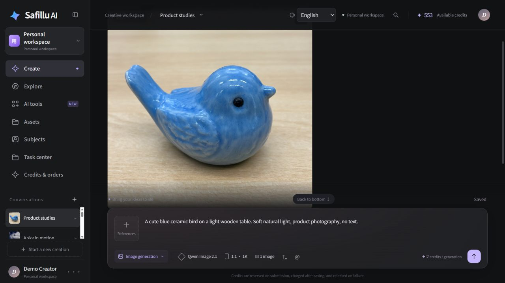
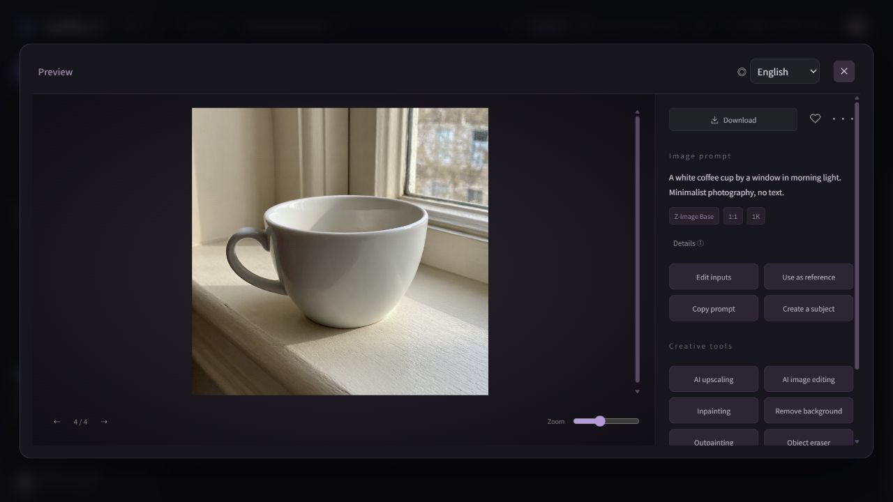
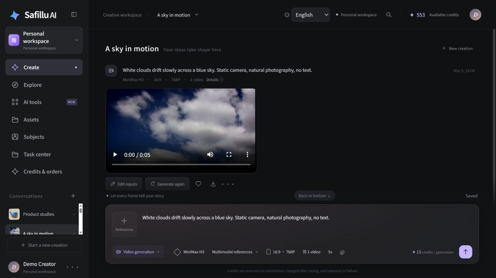
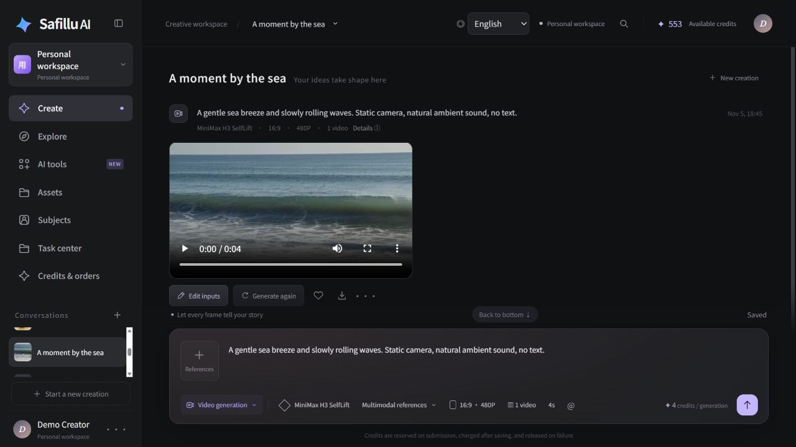
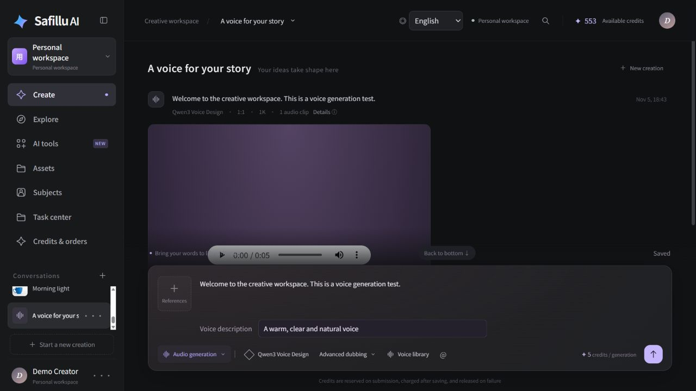
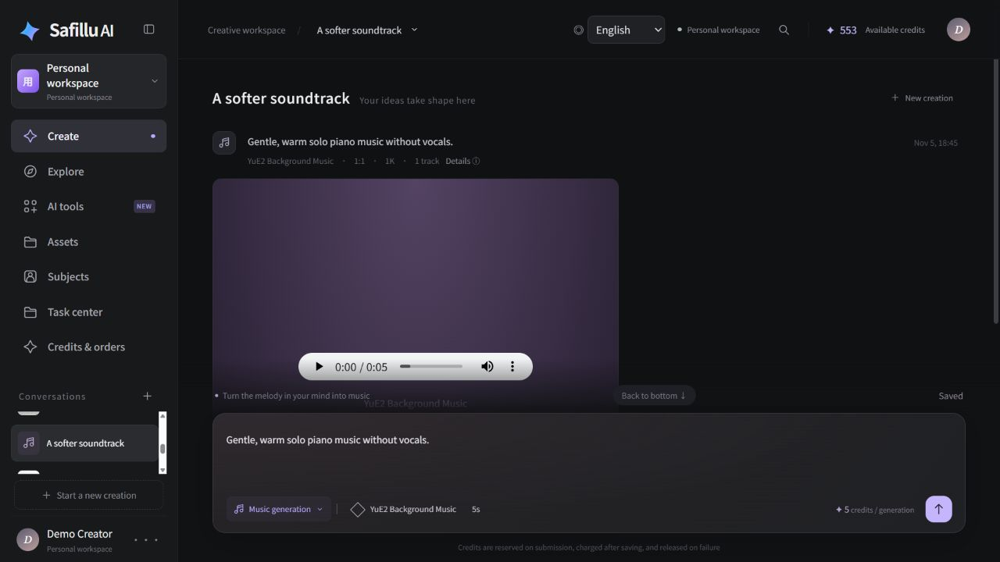
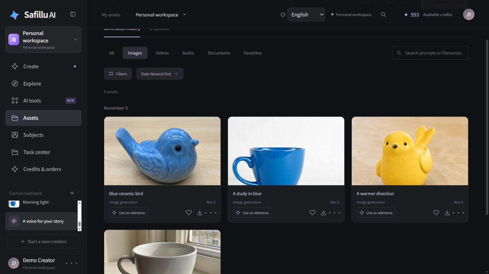
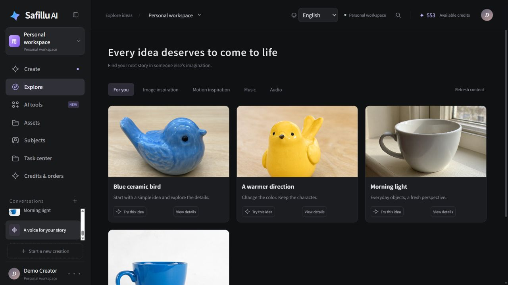
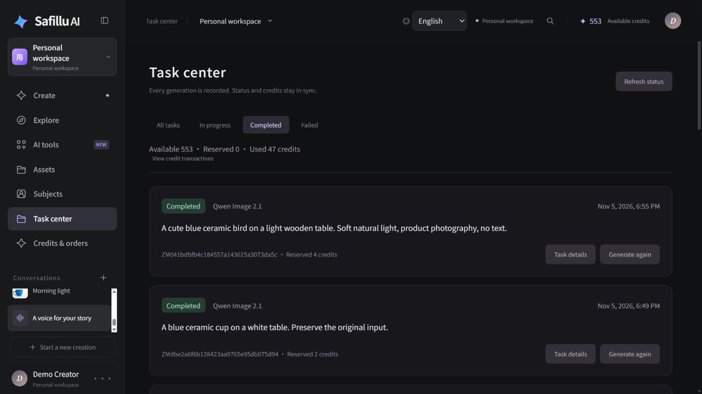

<div align="center">

# Safillu

### Creación con IA más abierta y accesible.

Crea vídeos, imágenes, voces y música en un solo espacio.<br>
Código abierto. Autoalojado. Un punto de partida para tu propia plataforma de IA.

[English](README.md) · [简体中文](README.zh-CN.md) · **Español**

[](LICENSE)
[](#inicio-rápido)
[](#configuración-y-credenciales)

[Nuestra visión](#nuestra-visión) · [Funciones](#lista-de-funciones) · [Hoja de ruta](#hoja-de-ruta-funciones-previstas) · [Empezar](#inicio-rápido) · [Credenciales](docs/credentials.es.md) · [Informe de pruebas](docs/test-report.es.md) · [Guía de despliegue](docker/README.txt) · [Proponer una idea](https://github.com/unrulpkk/safillu-aigc/issues)



</div>

**Safillu lleva el flujo creativo de Jimeng AI (即梦 AI) a una plataforma de código abierto y autoalojada para crear vídeos e imágenes con IA.** Parte de una idea, sigue la generación, prueba otra versión recuperando los ajustes anteriores y guarda los resultados en tu biblioteca.

Para quienes desarrollan un **SaaS de creación con IA**, Safillu también incluye cuentas, créditos, un panel de administración, gestión de contenidos y despliegue con Docker.

## Así es Safillu

Estas diez capturas utilizan imágenes, vídeos, voz y música guardados de pruebas anteriores con solicitudes reales a los modelos, en la interfaz real en inglés. Los títulos, las traducciones de las instrucciones, la agrupación de proyectos y la galería Explorar se han preparado para la presentación; el nombre del perfil es ficticio. Los archivos generados no se han modificado y el historial conserva los estados y saldos registrados. Consulta el [informe de pruebas](docs/test-report.es.md) para conocer la verificación y las limitaciones de los proveedores.

| De texto a imagen | Previsualización y reutilización |
| --- | --- |
| [](docs/images/safillu-images-en.jpg) | [](docs/images/safillu-preview-en.jpg) |
| **Qwen Image 2.1**: un resultado guardado de fotografía de producto. | **Z-Image Base**: examina el resultado, copia las instrucciones o reutilízalo como referencia. |

| Vídeo: un cielo en movimiento | Vídeo: un momento junto al mar |
| --- | --- |
| [](docs/images/safillu-video-clouds-en.jpg) | [](docs/images/safillu-video-sea-en.jpg) |
| **MiniMax H3**: cinco segundos de nubes. | **MiniMax H3 SelfLift**: cuatro segundos en la costa. |

| Generación de voz | Generación de música |
| --- | --- |
| [](docs/images/safillu-voice-en.jpg) | [](docs/images/safillu-music-en.jpg) |
| **Qwen3 Voice Design**: reproducción de voz y descripción del timbre. | **YuE2**: una pieza instrumental guardada. |

| Conserva tus creaciones | Descubre tu próxima idea |
| --- | --- |
| [](docs/images/safillu-assets-en.jpg) | [](docs/images/safillu-explore-en.jpg) |
| **Biblioteca de recursos**: pájaros y tazas generados, listos para previsualizar y reutilizar. | **Explorar**: una galería preparada con los mismos resultados generados. |

<details>
<summary><strong>Centro de tareas: solicitudes reales completadas, historial y contabilidad de créditos</strong></summary>



</details>

## Nuestra visión

Nuestra visión es facilitar un **acceso equitativo a la tecnología y a los modelos de IA**. Mediante la colaboración de la comunidad de código abierto, queremos reducir las barreras para crear vídeos e imágenes con IA, de modo que los creadores puedan elegir modelos, desplegar servicios y desarrollar sus propios flujos de trabajo creativos.

## De una idea a algo que merece la pena guardar

| Crea | Mantén el proceso organizado |
| --- | --- |
| **Vídeos con IA** | Envía tareas de generación, consulta su estado y recupera intentos anteriores. |
| **Imágenes con IA** | Genera a partir de texto, utiliza referencias y modelos de edición compatibles y guarda los resultados. |
| **Voz y música** | Utiliza modelos de voz y música junto a tus proyectos visuales. |
| **Tu biblioteca de recursos** | Sube, previsualiza, descarga, marca como favoritos y reutiliza materiales. |
| **Tu propia plataforma de IA** | Gestiona usuarios, roles, contenido de Explorar, créditos y configuración de pagos. |

### Las buenas ideas suelen necesitar más de una generación

1. **Describe la idea.** Elige el modo de creación, el modelo y los ajustes.
2. **Genera y sigue la tarea.** Conserva el estado y el historial de la creación.
3. **Prueba otra dirección.** La regeneración recupera las instrucciones y las entradas anteriores para que puedas modificarlas.
4. **Guarda lo que funciona.** Encuentra los resultados en tu biblioteca y reutilízalos en próximas creaciones.

### Un estudio para crear. Una base para desarrollar.

- **Creadores:** reúne instrucciones, historial de generación y archivos en un mismo lugar.
- **Desarrolladores:** empieza con una interfaz de creación, un backend Java y el panel nativo de Yudao.
- **Gestores de contenidos:** publica contenido de Explorar y administra cuentas desde el mismo sistema que utiliza el sitio de creación.
- **Usuarios de distintos idiomas:** cambia entre chino, inglés y español.

## Lista de funciones

«Implementado» describe el soporte de la aplicación. La generación, el almacenamiento en la nube, el acceso externo y los pagos también dependen de las credenciales y de la disponibilidad de sus proveedores.

| Área | Funciones | Estado |
| --- | --- | --- |
| Cuentas | Registro con correo, código de verificación y contraseña; acceso por correo o usuario existente; actualización del perfil y contraseña; espacios personales persistentes | Implementado; el registro por correo requiere SMTP |
| Acceso con Google | Callback OAuth, creación de cuentas y acceso | Implementado; requiere OAuth |
| Imágenes | Generación desde texto y edición con imágenes de referencia mediante modelos compatibles | Implementado; requiere proveedor |
| Vídeos | Texto e imágenes; Best MiniMax H3 admite referencias mixtas de imagen, audio y vídeo mediante URL | Implementado; requiere proveedor |
| Voz y música | Narración, descripción de la voz, velocidad y generación de música de fondo | Implementado; requiere proveedor |
| Ajustes de generación | Modelo, proporciones, resoluciones, duraciones y cantidades compatibles | Implementado según los límites del modelo |
| Tareas | Cola persistente, estados y progreso, historial, filtros, detalles, paginación y cancelación en cola | Implementado |
| Regeneración | Recuperar instrucciones, modelo, parámetros y referencias originales; crear un intento nuevo | Implementado |
| Conversaciones y borradores | Crear, renombrar, fijar y eliminar conversaciones; guardar borradores por modo | Implementado |
| Recursos | Subida, vista previa de imagen/audio/vídeo, descarga, búsqueda/filtros, favoritos, ZIP por lotes, papelera y restauración | Implementado |
| Caché de medios | Portadas de fotogramas reales, caché limitada por cuenta y reproducción conservada durante el sondeo | Implementado |
| Personajes y borradores de edición | Guardar materiales de personajes, referencias mediante `@` y borradores | Implementado; no implica consistencia de personajes con IA |
| Créditos | Presupuesto, reserva, liquidación tras almacenar resultados, liberación en fallos/cancelaciones, movimientos e idempotencia | Implementado |
| Recargas Stripe | Paquetes, Checkout alojado, pedidos, webhooks firmados y contabilidad de reembolsos/disputas | Implementado; requiere Stripe y paquetes |
| Almacenamiento | Volumen local, R2 público prioritario, compatibilidad con Qiniu anterior y archivo de resultados antes del éxito | Implementado; la nube requiere credenciales |
| Explorar y operaciones | Contenido del backend, publicación/retirada, categorías y reutilización de plantillas; gestión de modelos, espacios, tareas, recursos, pedidos, paquetes y movimientos | Implementado |
| Administración nativa | Usuarios, roles, menús, departamentos, diccionarios, ajustes, registros y archivos de Yudao; permisos de administrador y operador | Implementado |
| Idiomas y despliegue | Interfaces de creación y administración en chino, inglés y español; Docker, inicialización, comprobaciones de salud, configuración privada y migraciones | Implementado |

Los flujos completos de avatares digitales, imitación de movimientos, escucha previa/clonación de voces y algunas herramientas de imagen siguen pendientes. El estado de WeChat Pay está en la [guía de credenciales](docs/credentials.es.md#wechat-pay-pendiente-de-integración-en-esta-aplicación); el lienzo, la consistencia de personajes y los agentes aparecen en la hoja de ruta.

## Modelos abiertos y generación mediante proveedores

Safillu utiliza API de proveedores para conectar modelos de imagen, vídeo, voz y música. Su registro actual incluye **Qwen Image 2.1**, **Z-Image Base**, **Qwen Image 2.1 Edit**, **MiniMax H3 / SelfLift**, **Best MiniMax H3**, **Qwen3-TTS VoiceDesign** y **YuE2 BGM**. Best MiniMax H3 acepta referencias mediante URL públicas: hasta 9 imágenes, 3 audios y 3 vídeos, con vídeos de 4–15 segundos en los niveles de resolución configurados.

Los archivos de referencia se suben primero al almacenamiento público R2. Best MiniMax H3 recibe URL públicas; el endpoint antiguo de edición de Qwen conserva el formato Base64 que requiere.

El flujo con URL públicas se ha verificado con Best MiniMax H3: subida a R2, generación, almacenamiento de resultados, regeneración con las entradas originales y liquidación de créditos. Las pruebas reales cubrieron vídeos de 4 segundos y 480P.

La plataforma combina modelos abiertos con servicios de generación alojados por proveedores. La disponibilidad depende de la configuración del proveedor y cada modelo tiene su propia licencia. Docker despliega la aplicación; la generación utiliza las API configuradas. Los pesos y un servidor local de inferencia GPU se gestionan por separado.

## Hoja de ruta (funciones previstas)

Las siguientes líneas de trabajo están previstas para futuras versiones.

| Área | Trabajo previsto |
| --- | --- |
| **Despliegue local de modelos de código abierto** | Conectar servicios locales de inferencia con GPU y ofrecer herramientas para elegir, desplegar y ejecutar modelos. |
| **Lienzo visual** | Conectar instrucciones, recursos, pasos de generación y resultados en un flujo creativo editable. |
| **Sustitución y consistencia de personajes** | Sustituir personajes entre planos manteniendo su apariencia e identidad visual. |
| **Agente para producir microdramas** | Conectar guiones, guiones gráficos, personajes, voces en off y generación de vídeo para facilitar la producción de microdramas. |
| **Seguimiento de tendencias de vídeos populares** | Observar temas, estructuras narrativas y estilos visuales para descubrir nuevas líneas creativas. |
| **Flujos reutilizables inspirados en vídeos populares** | Analizar el ritmo, los planos y la estructura narrativa para crear plantillas reutilizables. |
| **Vídeos científicos y educativos** | Ayudar a organizar explicaciones, guiones gráficos, voces en off e imágenes en torno a un tema de conocimiento. |

## Inicio rápido

Instala Docker Engine y Docker Compose v2.20 o posterior. Se recomiendan 4 núcleos de CPU, 8 GB de RAM y 15 GB de espacio libre. La primera compilación necesita acceso a los registros de imágenes y dependencias. No es necesario instalar Java, Node.js, MySQL ni Redis en el equipo anfitrión.

Con los tres directorios de código fuente presentes, ejecuta desde este directorio:

```bash
sh ./start.sh
```

El script compila las imágenes de forma secuencial, crea credenciales privadas, inicializa la base de datos y espera a que los servicios estén listos. Incluye las dos interfaces, el backend Java 21, MySQL 8.4, Redis 7 y los contenedores de inicialización.

| Servicio | Dirección predeterminada |
| --- | --- |
| Espacio de creación | http://localhost:8088 |
| Administración | http://localhost:8089 |

La base de datos predeterminada es `safillu`. Las cuentas iniciales son `admin` (administrador) y `contentops` (gestor de contenidos). Sus contraseñas aleatorias se guardan en `.runtime/secrets/initial-accounts.json`; no existe una contraseña predeterminada común. En Linux puede ser necesario usar `sudo` para leer este archivo.

Si los puertos están ocupados, copia `.env.example` a `.env.local` y modifica `WEB_PORT`, `ADMIN_PORT` y `PUBLIC_ORIGIN` antes de iniciar.

<details>
<summary><strong>Detalles de despliegue: configuración, arquitectura y operación</strong></summary>

## Configuración y credenciales

La base técnica es **Java 21 · Spring Boot · ruoyi-vue-pro / Yudao · Administración Vue · MySQL · Redis · Docker Compose**. Ambas interfaces comparten base de datos, autenticación y permisos nativos. Google y Stripe requieren configurar tus propias cuentas.

La **[guía independiente de credenciales](docs/credentials.es.md)** reúne las páginas de solicitud, archivos, activación y diagnóstico de modelos, R2, Qiniu, Google, Stripe, RunPod, secretos generados y el estado de WeChat Pay. Las variables de despliegue y la estructura permanecen en este README.

| Archivo o directorio | Uso | ¿Se incluye en Git? |
| --- | --- | --- |
| `.env.example` | Plantilla local sin credenciales | Sí |
| `.env.prod.example` | Plantilla de producción sin credenciales | Sí |
| `.env.local` / `.env.prod.local` | Configuración privada de cada entorno | No |
| `.runtime/secrets/` | Contraseñas, claves de cifrado y credenciales de proveedores | No |
| `application-local.yaml` / `application-dev.yaml` | Configuración privada de desarrollo Java | No |

### Configurar `.env.example`

En la primera instalación, crea el archivo privado con uno de estos comandos. Si ya existe, edítalo sin sobrescribirlo. El script de inicio también copia automáticamente la plantilla adecuada cuando falta el archivo de destino.

```bash
# Linux / macOS
cp .env.example .env.local
```

```powershell
# Windows PowerShell
Copy-Item .env.example .env.local
```

Las plantillas raíz controlan Docker, no los ajustes frontend `VITE_`, y no contienen contraseñas ni API keys. Compose lee el archivo seleccionado; sus variables no se exportan automáticamente al shell.

| Variable | Valor predeterminado / ejemplo | Qué configurar |
| --- | --- | --- |
| `COMPOSE_PROJECT_NAME` | `safillu` | Prefijo de contenedores, red y volúmenes; utiliza otro nombre para una instalación independiente. |
| `DB_NAME` | `safillu` | Base de datos exclusiva del proyecto; elígela antes de inicializar. |
| `DB_USERNAME` | `safillu_app` | Usuario de la aplicación, distinto de `root`; su contraseña se genera de forma privada. |
| `WEB_PORT` | `8088` | Puerto publicado del sitio de creación. |
| `ADMIN_PORT` | `8089` | Puerto publicado del panel Yudao. |
| `PUBLIC_ORIGIN` | `http://localhost:8088` | Origen de creación que ve el navegador, con protocolo y puerto si corresponde; utiliza HTTPS en producción. Determina el retorno de Google y Stripe. |
| `SAFILLU_RUNTIME_DIR` | `./.runtime` | Directorio privado cuyo subdirectorio `secrets/` se monta en `/run/secrets`. |
| `GOOGLE_REDIRECT_URI` | Vacío en la plantilla local | Al habilitar Google, indica el callback registrado exacto. Vacío utiliza `http://localhost:8088/app-api/member/auth/google-login`; actualízalo al cambiar dominio o puerto. |
| `QINIU_STORAGE_BOOTSTRAP` | `false` | `true` para verificar y seleccionar un almacenamiento Qiniu configurado al iniciar. |
| `R2_STORAGE_BOOTSTRAP` | `auto` | Prioriza R2 configurado y verificado. `false` omite la activación inicial de R2; `true` la solicita explícitamente. |
| `STRIPE_MODE` | `TEST` | Entorno de claves y datos de Stripe: `TEST` o `LIVE`, independiente del perfil Java de producción. |
| `STRIPE_LIVE_ENABLED` | `false` | Interruptor adicional de cobros reales, después de preparar y verificar claves, paquetes y webhooks. |
| `STRIPE_PUBLIC_WEBHOOK_URL` | Vacío localmente | Para Stripe con recepción pública, `https://YOUR_CREATOR_DOMAIN/admin-api/aigc/payments/stripe/webhook`; el reenvío local por CLI está en la guía de credenciales. |
| `JAVA_OPTS` | `-Xms128m -Xmx768m` | Ajustes JVM opcionales; deja margen para memoria fuera del heap dentro del límite de `1200m`. |

Por ejemplo, para cambiar los puertos locales:

```dotenv
WEB_PORT=18088
ADMIN_PORT=18089
PUBLIC_ORIGIN=http://localhost:18088
GOOGLE_REDIRECT_URI=http://localhost:18088/app-api/member/auth/google-login
```

Los valores predeterminados permiten iniciar sin credenciales externas: se usa almacenamiento local, la generación espera una clave y el acceso externo y los pagos esperan sus credenciales. Al habilitar Google o Stripe, las direcciones deben coincidir con las registradas en sus servicios.

Para producción, copia `.env.prod.example` a `.env.prod.local`, sustituye los marcadores de dominio, configura HTTPS mediante un proxy inverso y ejecuta:

```bash
sh ./start.sh .env.prod.local
```

En Windows utiliza `.\start.ps1 -EnvFile .env.prod.local`. Ambas plantillas mantienen Stripe en `TEST` de forma intencionada. Utiliza el mismo archivo de entorno en los comandos posteriores. Vuelve a ejecutar el script de inicio para aplicar cambios; reiniciar un contenedor no sustituye su entorno.

Cambiar el nombre del proyecto, los identificadores de base de datos o el directorio privado no migra una instalación existente. Los interruptores de almacenamiento verifican y seleccionan el principal; no migran archivos ni sustituyen automáticamente el principal anterior al desactivarse. En modo `auto`, R2 configurado tiene prioridad sobre Qiniu. No establezcas ambos interruptores explícitamente en `true`.

Guarda las credenciales reales de los modelos, Google, Stripe y almacenamiento en archivos de secretos privados. No las incluyas en variables frontend `VITE_`, código fuente, archivos README ni YAML versionados. Solo se permite versionar configuración de compilación revisada y sin credenciales. Las reglas de exclusión no eliminan secretos que ya estén en el historial de Git.

Cloudflare R2 tiene prioridad automática cuando su configuración está completa y supera las pruebas de carga, lectura y eliminación. Si no está configurado o falla la verificación, se conserva el almacenamiento actual; las instalaciones nuevas sin credenciales de nube usan un volumen local persistente. Consulta la [plantilla de R2](docker/storage-r2.example.json). Los archivos existentes conservan sus identificadores de almacenamiento originales.

Las nuevas subidas, los resultados generados, las copias públicas de referencias y los recursos de Explorar usan claves planas `AAAAMMDD_UUID.ext` en la raíz del almacenamiento (fecha UTC), sin carpetas de inquilino, espacio, tarea o fecha. Las descargas de resultados generados usan el mismo formato. Las subidas conservan sus títulos originales; los archivos existentes siguen siendo legibles mediante sus rutas registradas.

Las rutas de los secretos y los comandos de activación se describen en la [guía de despliegue y configuración de proveedores](docker/README.txt), disponible actualmente en chino.

## Estructura del repositorio

```text
.
├── README.md / README.zh-CN.md / README.es.md  Proyecto, despliegue y configuración
├── .env.example / .env.prod.example          Plantillas sin credenciales
├── .env.local / .env.prod.local              Ajustes privados (excluidos de Git)
├── compose.yaml                             Conjunto completo de servicios
├── start.sh / start.ps1                      Inicio para Linux/macOS y Windows
├── docs/
│   ├── credentials*.md                      Guías de credenciales en tres idiomas
│   ├── test-report*.md                      Informes de pruebas en tres idiomas
│   ├── test-results.json                    Resumen de verificación depurado
│   └── images/                              Ilustraciones públicas del README
├── docker/                                  Imágenes, inicialización y verificación
├── lumina-studio/
│   ├── dist/                                Código y recursos del sitio de creación
│   ├── test/                                Pruebas unitarias del frontend
│   └── server.cjs                           Servidor opcional de desarrollo/archivos
├── zaomeng-admin/
│   ├── src/                                 Código del panel Vue nativo de Yudao
│   └── public/                              Recursos públicos del panel
├── zaomeng-backend/
│   ├── server/
│   │   ├── yudao-server/                    Entrada Java y perfiles de entorno
│   │   ├── yudao-module-aigc/               Creación, tareas, recursos, créditos e integraciones
│   │   ├── yudao-module-system/             Usuarios, roles y autenticación nativos
│   │   ├── yudao-module-infra/              Archivos y servicios de infraestructura
│   │   └── yudao-framework/                 Componentes compartidos
│   ├── database/mysql/                      Esquema y migraciones incrementales
│   ├── deploy/                              Material y plantillas de despliegues antiguos
│   └── scripts/                             Herramientas de mantenimiento y aceptación
└── .runtime/                                Credenciales y pruebas privadas (excluidas de Git)
```

`compose.yaml` inicia `web`, `admin`, `backend`, `mysql` y `redis`, además de los servicios de una sola ejecución `secrets-init` y `db-init`. Las dos interfaces acceden al backend compartido mediante sus proxies; MySQL, Redis y Java no publican puertos del anfitrión.

Edita la interfaz de creación en `lumina-studio/dist/`, el panel en `zaomeng-admin/src/` y la lógica de negocio en `yudao-module-aigc/`; añade cambios de base de datos como migraciones nuevas. El Compose raíz corresponde a instalaciones nuevas. `zaomeng-backend/deploy/` conserva material antiguo y sus inicializadores no son intercambiables sobre bases de datos existentes.

Se mantienen los nombres históricos de los directorios por compatibilidad; el producto se llama Safillu. El directorio `dist/` del sitio de creación es actualmente una entrada de código de la aplicación y debe versionarse. Los directorios `dist*` generados del panel de administración se excluyen.

El espacio de trabajo puede contener repositorios Git anidados. El `.gitignore` raíz no los convierte en directorios normales: al añadirlos se puede crear un enlace Git en lugar de incluir su código. Antes de publicar un monorepositorio completo, decide cómo conservar o integrar sus historiales.

## Operación y verificación

```bash
docker compose --env-file .env.local ps -a
docker compose --env-file .env.local logs --tail=100 backend db-init
docker compose --env-file .env.local down
```

La parada normal conserva los volúmenes. Haz copias de seguridad conjuntas de los datos MySQL, el volumen de archivos y `.runtime/secrets/`. `down -v` elimina los volúmenes; perder las claves de cifrado puede impedir leer archivos anteriores. El instalador nuevo rechaza bases de datos existentes sin historial de migraciones de Safillu.

En una instalación de pruebas aislada en Linux, ejecuta:

```bash
python docker/test_bootstrap.py
python docker/smoke-test.py .env.local http://127.0.0.1:8088 http://127.0.0.1:8089
python docker/validation/email-registration-test.py .env.local
```

La prueba usa el administrador nativo para crear un usuario y después crea conversaciones y archivos reales. La prueba de registro usa HTTP, MySQL, Redis y un receptor SMTP local; requiere un proyecto con `qa` o `smoke` en el nombre, sin cuentas SMTP configuradas, y no envía correo externo. Repítela después de reiniciar para comprobar la persistencia. `docker/guard-test.py` verifica los rechazos del instalador y solo se permite en proyectos cuyo nombre contenga `smoke` o `qa`. Las simulaciones de R2 se ejecutan al compilar la imagen Java. El [informe de pruebas depurado](docs/test-report.es.md) se incluye en `docs/`; los registros originales, credenciales y capturas privadas quedan fuera de Git.

</details>

## Hazlo tuyo

**¿Estás creando una herramienta de vídeo con IA, un espacio de generación de imágenes o tu propio SaaS AIGC?** Prueba Safillu, comparte tu configuración sin credenciales y cuéntanos qué proceso creativo te gustaría incorporar.

Si te resulta útil, **dale una estrella** para que más creadores y desarrolladores lo descubran. Puedes aportar errores reproducibles, adaptadores de modelos y mejoras de traducción mediante [Issues](https://github.com/unrulpkk/safillu-aigc/issues) y pull requests. Elimina las credenciales y los datos personales de los ejemplos.

## Licencia

Safillu es un proyecto independiente inspirado en Jimeng, sin afiliación con Jimeng ni ByteDance. El código de la aplicación se distribuye bajo la [licencia MIT](LICENSE); los avisos originales y las licencias de los modelos siguen siendo aplicables.
