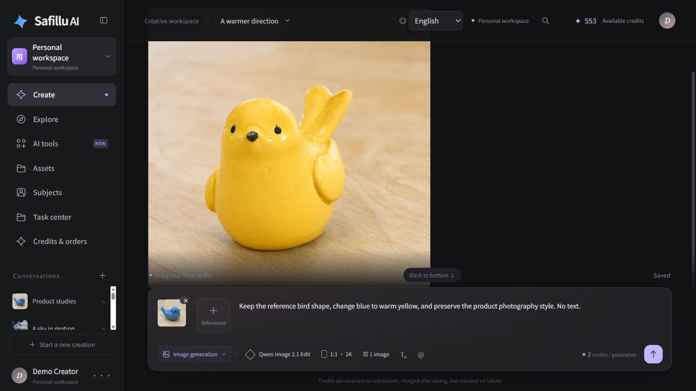
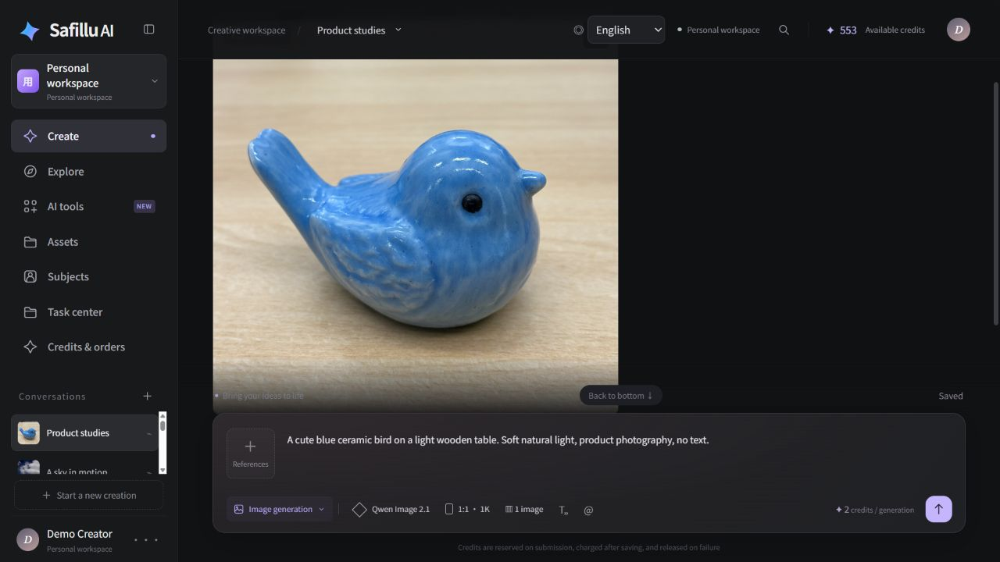
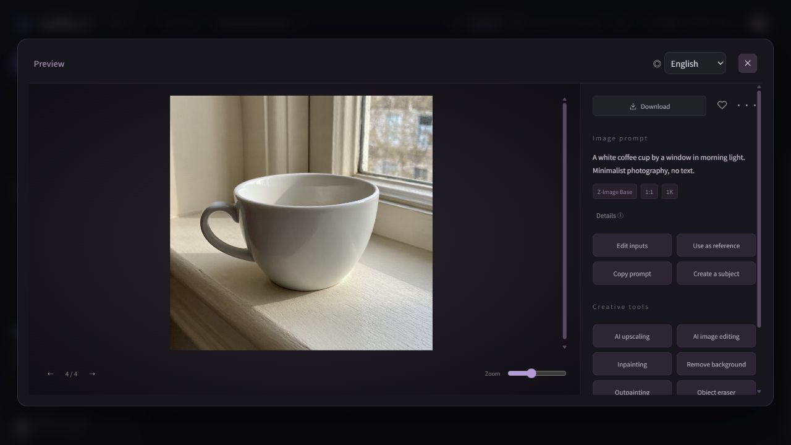
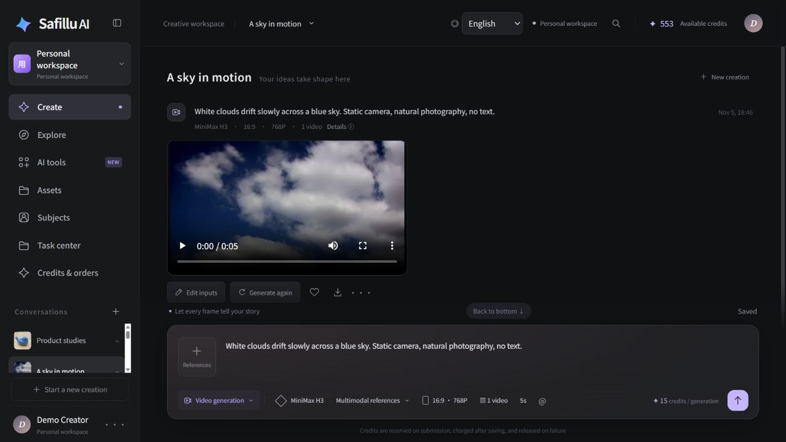
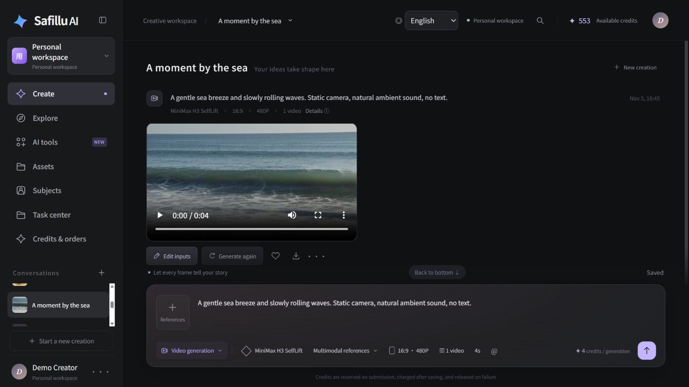
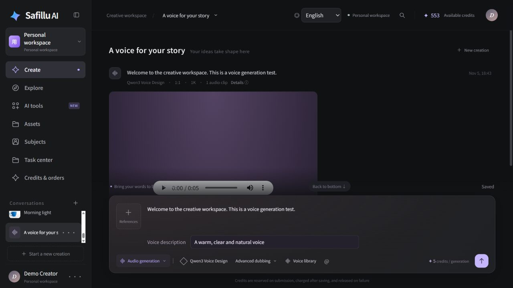
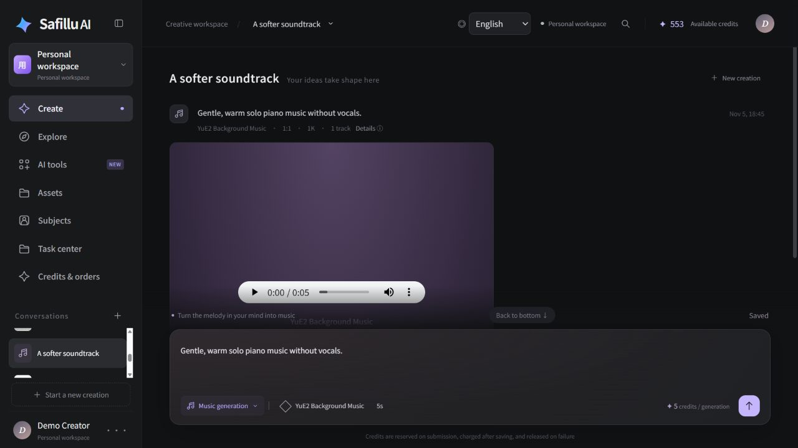
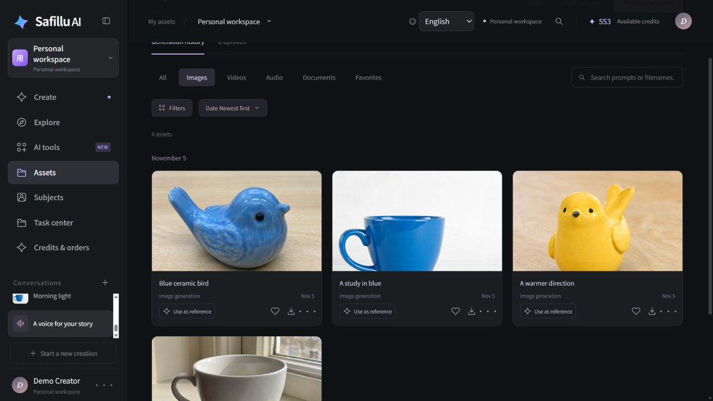
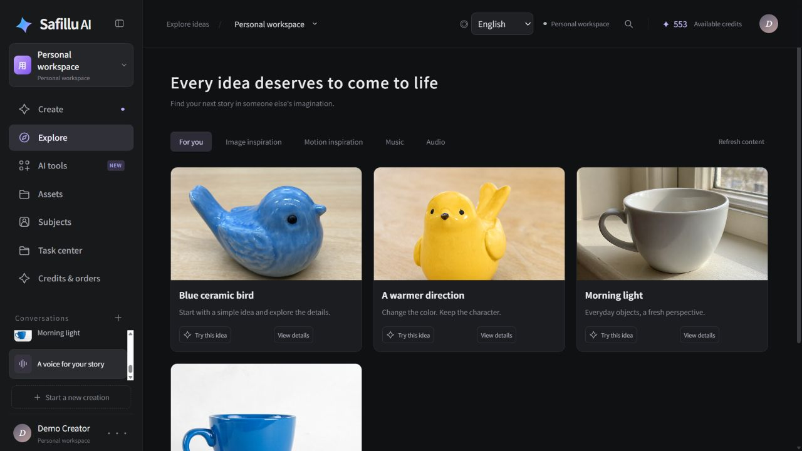
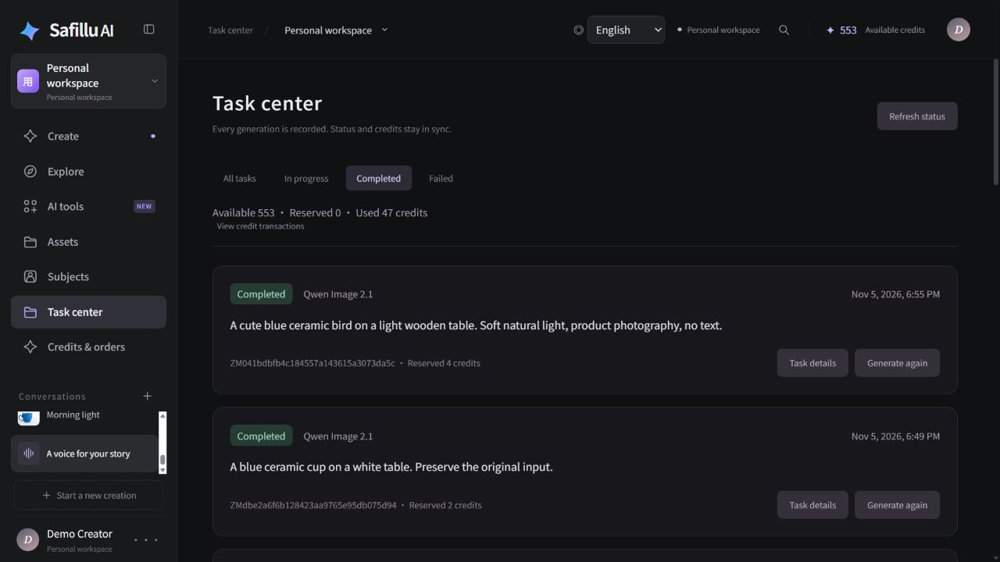

<div align="center">

# Safillu

### Making AI creation more open and accessible.

Create videos, images, voices, and music in one workspace.<br>
Open source. Self-hosted. A starting point for your own AI platform.

**English** · [简体中文](README.zh-CN.md) · [Español](README.es.md)

[](LICENSE)
[](#quick-start)
[](#configuration-and-credentials)

[Our vision](#our-vision) · [Features](#feature-list) · [Roadmap](#roadmap-planned) · [Get started](#quick-start) · [Credentials](docs/credentials.md) · [Test report](docs/test-report.md) · [Deployment guide](docker/README.txt) · [Share an idea](https://github.com/unrulpkk/safillu-aigc/issues)



</div>

**Safillu brings the creative workflow of Jimeng AI (即梦 AI) to an open-source, self-hosted AI video and image creation platform.** Start with a prompt, follow the generation, try another direction with your original settings, and keep the results in your asset library.

Building an **AI creative SaaS**? Safillu also provides the foundations around generation: accounts, credits, an administration panel, content operations, and Docker deployment.

## A look inside Safillu

These ten screenshots use saved image, video, speech, and music outputs from earlier live generation tests in the actual English interface. Titles, prompt translations, project groupings, and the Explore gallery are curated for presentation; the profile name is a placeholder. Generated media are unchanged, and the task history retains its recorded statuses and credit balances. See the [test report](docs/test-report.md) for verification and provider limitations.

| Text-to-image | Preview and reuse |
| --- | --- |
| [](docs/images/safillu-images-en.jpg) | [](docs/images/safillu-preview-en.jpg) |
| **Qwen Image 2.1** — a saved product-photography result. | **Z-Image Base** — inspect a result, copy the prompt, or reuse it as a reference. |

| Video: a sky in motion | Video: a moment by the sea |
| --- | --- |
| [](docs/images/safillu-video-clouds-en.jpg) | [](docs/images/safillu-video-sea-en.jpg) |
| **MiniMax H3** — a five-second cloud scene. | **MiniMax H3 SelfLift** — a four-second coastal scene. |

| Speech generation | Music generation |
| --- | --- |
| [](docs/images/safillu-voice-en.jpg) | [](docs/images/safillu-music-en.jpg) |
| **Qwen3 Voice Design** — speech playback and voice description. | **YuE2** — a saved instrumental soundtrack. |

| Keep your creations | Discover your next idea |
| --- | --- |
| [](docs/images/safillu-assets-en.jpg) | [](docs/images/safillu-explore-en.jpg) |
| **Asset library** — actual generated birds and cups, ready to preview and reuse. | **Explore** — a showcase gallery curated from the same generated results. |

<details>
<summary><strong>Task center: actual completed requests, history, and credit accounting</strong></summary>



</details>

## Our vision

Our vision is **equal access to technology and AI models**. Through open-source collaboration, we aim to lower the barriers to AI video and image creation, so creators can choose models, deploy services, and gradually build their own creative workflows.

## From an idea to something worth keeping

| Create | Keep the workflow together |
| --- | --- |
| **AI videos** | Submit generation tasks, follow their status, and revisit previous attempts. |
| **AI images** | Generate from text, use supported reference-image and editing models, and save the results. |
| **Voice and music** | Work with speech and music models alongside your visual projects. |
| **Your asset library** | Upload, preview, download, favorite, and reuse creative materials. |
| **Your own AI platform** | Manage users, roles, exploration content, credits, and payment configuration. |

### Good ideas usually take more than one generation

1. **Describe the idea.** Choose a creation mode, model, and settings.
2. **Generate and follow the task.** Keep the status and history attached to the creation.
3. **Try another direction.** Regeneration restores previous prompts and inputs, ready to edit.
4. **Keep what works.** Find results in your library and use them in later creations.

### A studio for creators. A starting point for builders.

- **Creators:** keep prompts, generation history, and assets in one place.
- **Developers:** start with a creator frontend, Java backend, and native Yudao administration panel.
- **Operators:** publish exploration content and manage accounts through the same system that serves the creator website.
- **A global audience:** switch between Chinese, English, and Spanish.

## Feature list

“Implemented” describes application support. Model generation, cloud storage, external sign-in, and payments also depend on the relevant credentials and provider availability.

| Area | Features | Status |
| --- | --- | --- |
| Accounts | Email registration with a verification code and password, email/password login (existing usernames supported), profile and password updates, persistent personal workspaces | Implemented; SMTP required for email registration |
| Google sign-in | OAuth callback, account creation/login | Implemented; configure OAuth |
| Images | Text-to-image and reference-image editing through supported models | Implemented; configure model service |
| Videos | Text/image inputs; Best MiniMax H3 also accepts image, audio, and video URL references | Implemented; configure model service |
| Speech and music | Text narration, voice description, speech speed, background music generation | Implemented; configure model service |
| Generation settings | Model selection and supported ratios, resolutions, durations, and output counts | Implemented, within model limits |
| Tasks | Durable queue, status/progress events, history, filters, task details, pagination, queued-task cancellation | Implemented |
| Regeneration | Restore the original prompt, model, options, and reference assets; create a new recorded attempt | Implemented |
| Conversations and drafts | Create, rename, pin, and delete conversations; save drafts for creation modes | Implemented |
| Assets | Upload, image/audio/video preview, download, search/filter, favorites, bulk ZIP export, trash and restore | Implemented |
| Media cache | Real video-frame conversation covers, account-scoped bounded browser cache, playback preserved during task polling | Implemented |
| Subjects and edit drafts | Save subject materials, reference them with `@`, and preserve edit drafts | Implemented; does not imply AI character consistency |
| Credits | Quotes, reservations, settlement after archival, release on failure/cancellation, ledger and duplicate-request protection | Implemented |
| Stripe top-ups | Credit packs, hosted Checkout, orders, signed webhook handling, refund/dispute accounting | Implemented; configure Stripe and packs |
| Storage | Persistent local uploads, preferred public R2, compatible historical Qiniu storage, archival before success | Implemented; cloud credentials required for cloud storage |
| Exploration and operations | Backend-managed content, publish/unpublish, categories and template reuse; manage models, workspaces, tasks, assets, orders, packs, and ledgers | Implemented |
| Native administration | Yudao users, roles, menus, departments, dictionaries, system settings, logs and file management; administrator/operator permissions | Implemented |
| Languages and deployment | Chinese, English and Spanish creator/admin interfaces; Docker services, initialization, health checks, private configuration and incremental migrations | Implemented |

Full generation flows for digital humans, motion imitation, voice preview/cloning, and some image tools remain unconnected. WeChat Pay's status is documented in the [credential guide](docs/credentials.md#wechat-pay-not-wired-into-this-applications-checkout-yet); future canvas, character-consistency, and agent work appears in the planned roadmap below.

## Open models and hosted generation

Safillu uses provider APIs to connect image, video, speech, and music models. Its current registry includes **Qwen Image 2.1**, **Z-Image Base**, **Qwen Image 2.1 Edit**, **MiniMax H3 / SelfLift**, **Best MiniMax H3**, **Qwen3-TTS VoiceDesign**, and **YuE2 BGM**. Best MiniMax H3 accepts public URL references: up to 9 images, 3 audio clips, and 3 videos, with 4–15 second outputs across the configured resolution tiers.

Reference media are uploaded to public R2 storage first. Best MiniMax H3 receives public URLs; the legacy Qwen editing endpoint retains its required Base64 request format.

The public-URL workflow has been verified with Best MiniMax H3: R2 upload, generation, result archiving, regeneration with the original inputs, and credit settlement. Live acceptance covered 4-second 480P videos.

This combines open-model integrations with hosted generation services. Available models and features depend on your configured provider; model licenses apply separately. Docker runs the application, while generation uses provider APIs. Model weights and a local GPU inference server are separate.

## Roadmap (planned)

The following directions are planned for future development.

| Direction | Planned work |
| --- | --- |
| **Local deployment of open-source models** | Connect local GPU inference services and provide tools for choosing, deploying, and running models. |
| **Visual canvas** | Connect prompts, assets, generation steps, and results in an editable creative workflow. |
| **Character replacement and consistency** | Replace characters across shots while maintaining their appearance and visual identity. |
| **Short-drama production agent** | Connect scripts, storyboards, characters, voiceovers, and video generation to assist short-drama production. |
| **Popular video trend tracking** | Follow emerging topics, storytelling structures, and visual styles to help identify creative directions. |
| **Reusable workflows inspired by popular videos** | Break down pacing, shots, and narrative structure into reusable creative templates. |
| **Science and educational videos** | Help organize explanations, storyboards, voiceovers, and visuals around a knowledge topic. |

## Quick start

Install Docker Engine and Docker Compose v2.20 or later. Recommended: 4 CPU cores, 8 GB RAM, and 15 GB free disk space. The first build needs network access to image and dependency registries. Java, Node.js, MySQL, and Redis do not need to be installed on the host.

Run from this directory with all three source directories present:

```bash
sh ./start.sh
```

The script builds images sequentially, creates private credentials, initializes the database, and waits for healthy services. The stack includes the creator frontend, administration frontend, Java 21 backend, MySQL 8.4, Redis 7, and initialization containers.

| Service | Default address |
| --- | --- |
| Creator workspace | http://localhost:8088 |
| Administration | http://localhost:8089 |

The default database is `safillu`. Initial accounts are `admin` (administrator) and `contentops` (content operator). Their random passwords are stored in `.runtime/secrets/initial-accounts.json`; there is no shared default password. On Linux, reading this file may require `sudo`.

If the default ports are already occupied, copy `.env.example` to `.env.local` and adjust `WEB_PORT`, `ADMIN_PORT`, and `PUBLIC_ORIGIN` before starting.

<details>
<summary><strong>Deployment details: configuration, architecture, and operations</strong></summary>

## Configuration and credentials

Built on **Java 21 · Spring Boot · ruoyi-vue-pro / Yudao · Vue administration · MySQL · Redis · Docker Compose**. The creator website and administration panel share one database and native authentication and permissions. Google login and Stripe require your own account configuration.

For every credential's application page, file location, activation steps, and troubleshooting, see the separate **[credentials guide](docs/credentials.md)**. It covers models, R2, Qiniu, Google, Stripe, upstream RunPod, generated secrets, and WeChat Pay's current integration status. This README contains the deployment variables and repository layout.

| File or directory | Purpose | Commit to Git? |
| --- | --- | --- |
| `.env.example` | Safe local deployment template | Yes |
| `.env.prod.example` | Safe production template | Yes |
| `.env.local` / `.env.prod.local` | Machine-specific settings | No |
| `.runtime/secrets/` | Database passwords, encryption keys, provider credentials | No |
| `application-local.yaml` / `application-dev.yaml` | Private Java development settings | No |

### Configure `.env.example`

On a first installation, create your private file using either command below. Edit an existing private file in place instead of overwriting it. The start script also copies the appropriate template automatically when its target file is missing.

```bash
# Linux / macOS
cp .env.example .env.local
```

```powershell
# Windows PowerShell
Copy-Item .env.example .env.local
```

The root `.env` templates control Docker deployment, not frontend `VITE_` settings. They contain no API keys or passwords. Compose reads the selected file; its variables are not automatically exported into your shell.

| Variable | Default / example | What to configure |
| --- | --- | --- |
| `COMPOSE_PROJECT_NAME` | `safillu` | Prefix for this installation's containers, network, and volumes. Choose a different name for a separate installation. |
| `DB_NAME` | `safillu` | Dedicated database name; choose before initialization. |
| `DB_USERNAME` | `safillu_app` | Application database user, not `root`; its password is generated privately. |
| `WEB_PORT` | `8088` | Host port for the creator website. |
| `ADMIN_PORT` | `8089` | Host port for Yudao administration. |
| `PUBLIC_ORIGIN` | `http://localhost:8088` | Browser-visible creator origin, including scheme and any non-default port; use your HTTPS domain in production. Used for Google and Stripe return addresses. |
| `SAFILLU_RUNTIME_DIR` | `./.runtime` | Private runtime directory. Its `secrets/` subdirectory is mounted at `/run/secrets`. |
| `GOOGLE_REDIRECT_URI` | Empty in the local template | Set the exact registered callback when enabling Google. Empty falls back to `http://localhost:8088/app-api/member/auth/google-login`, so update it when changing the origin or port. |
| `QINIU_STORAGE_BOOTSTRAP` | `false` | Set `true` only when verifying/selecting a configured Qiniu store at startup. |
| `R2_STORAGE_BOOTSTRAP` | `auto` | Prefer a configured, verified R2 store. `false` skips R2 bootstrap; `true` explicitly requests it. |
| `STRIPE_MODE` | `TEST` | Stripe credential/data environment: `TEST` or `LIVE`. Independent of the Java production profile. |
| `STRIPE_LIVE_ENABLED` | `false` | Additional switch for real payments; enable only after live credentials, credit packs, and webhooks are ready. |
| `STRIPE_PUBLIC_WEBHOOK_URL` | Empty locally | With Stripe configured, use `https://YOUR_CREATOR_DOMAIN/admin-api/aigc/payments/stripe/webhook` for public delivery; local CLI forwarding is described in the credential guide. |
| `JAVA_OPTS` | `-Xms128m -Xmx768m` | Optional JVM tuning. Leave room for non-heap memory within the backend's `1200m` container limit. |

For example, with different local ports:

```dotenv
WEB_PORT=18088
ADMIN_PORT=18089
PUBLIC_ORIGIN=http://localhost:18088
GOOGLE_REDIRECT_URI=http://localhost:18088/app-api/member/auth/google-login
```

With defaults, no third-party values are needed to start the application: local storage works, generation waits for a provider key, and optional sign-in/payments wait for their credentials. Google and Stripe URLs must match the addresses registered with those services.

For production, copy `.env.prod.example` to `.env.prod.local`, replace the domain placeholders, configure HTTPS through a reverse proxy, and run:

```bash
sh ./start.sh .env.prod.local
```

On Windows use `.\start.ps1 -EnvFile .env.prod.local`. Both templates intentionally keep Stripe in `TEST` mode. Use the same environment file for subsequent Compose commands. Rerun the start script to apply deployment changes; restarting an existing container alone does not replace its environment.

Do not change the project name, database identifiers, or runtime directory on an initialized installation as a shortcut to migration. Storage bootstrap flags verify/select a master; they do not migrate old files or automatically replace a previously selected master when disabled. In `auto` mode, configured R2 takes priority over Qiniu. Do not explicitly set both storage flags to `true`.

Store actual model, Google, Stripe, and storage credentials in private secret files. Do not put secrets in frontend `VITE_` variables, source code, README files, or committed YAML. Only reviewed, credential-free build configuration is allowed in Git. Git ignore rules do not remove secrets from existing commits.

Configured Cloudflare R2 is preferred automatically after upload, read, and delete verification. Without usable R2 configuration, the existing storage remains active; new installations without cloud credentials use a persistent local upload volume. See the [R2 configuration template](docker/storage-r2.example.json). Historical files retain their original storage configuration IDs.

New creator uploads, generated results, public reference copies, and exploration media use flat object keys: `YYYYMMDD_UUID.ext` at the storage root (UTC date), without tenant, workspace, task, or date directories. Generated download filenames use the same format. Uploaded assets retain their original display titles; existing files keep their recorded paths and remain readable.

See [deployment and provider configuration](docker/README.txt) for secret file locations and activation commands.

## Repository layout

```text
.
├── README.md / README.zh-CN.md / README.es.md  Project, deployment, and environment guides
├── .env.example / .env.prod.example          Credential-free deployment templates
├── .env.local / .env.prod.local              Private overrides (Git-ignored)
├── compose.yaml                             Complete service stack
├── start.sh / start.ps1                      Linux/macOS and Windows launchers
├── docs/
│   ├── credentials*.md                      Credential guides in three languages
│   ├── test-report*.md                      Multilingual test reports
│   ├── test-results.json                    Sanitized verification snapshot
│   └── images/                              Public README illustrations
├── docker/                                  Image builds, initialization, and verification
├── lumina-studio/
│   ├── dist/                                Creator frontend source and static assets
│   ├── test/                                Frontend unit tests
│   └── server.cjs                           Optional development/static server
├── zaomeng-admin/
│   ├── src/                                 Native Yudao Vue administration source
│   └── public/                              Public administration assets
├── zaomeng-backend/
│   ├── server/
│   │   ├── yudao-server/                    Java application entry and profiles
│   │   ├── yudao-module-aigc/               Creation, tasks, assets, credits, and integrations
│   │   ├── yudao-module-system/             Native users, roles, and authentication
│   │   ├── yudao-module-infra/              Native files and infrastructure services
│   │   └── yudao-framework/                 Shared framework components
│   ├── database/mysql/                      Schema and incremental migrations
│   ├── deploy/                              Legacy deployment assets and templates
│   └── scripts/                             Maintenance and acceptance tools
└── .runtime/                                Private credentials and local test state (ignored)
```

`compose.yaml` starts `web`, `admin`, `backend`, `mysql`, and `redis`, plus the one-time `secrets-init` and `db-init` services. The two websites proxy their APIs to the shared backend; MySQL, Redis, and Java have no public host ports in this stack.

Edit creator UI source in `lumina-studio/dist/`, administration source in `zaomeng-admin/src/`, business Java code in `yudao-module-aigc/`, and append database changes as new migrations. The root Compose stack is the supported fresh-install path; `zaomeng-backend/deploy/` also contains older deployment material and is not an interchangeable initializer for existing databases.

Legacy directory names are retained for compatibility; the product name is Safillu. The creator's `dist/` directory is currently an application source input and must remain versioned. The administration frontend's generated `dist*` directories are ignored.

This workspace may contain existing nested Git repositories. The root `.gitignore` does not convert them into ordinary directories: adding an embedded repository can create a Git link instead of including its source. Preserve or deliberately consolidate their histories before publishing a complete monorepo.

## Operations and verification

```bash
docker compose --env-file .env.local ps -a
docker compose --env-file .env.local logs --tail=100 backend db-init
docker compose --env-file .env.local down
```

Normal shutdown preserves volumes. Back up MySQL data, the upload volume, and `.runtime/secrets/` together. Removing volumes with `down -v` erases data; losing encryption keys can make historical files unreadable. The fresh installer refuses to take over an existing database without Safillu migration history.

On an isolated Linux test installation, run:

```bash
python docker/test_bootstrap.py
python docker/smoke-test.py .env.local http://127.0.0.1:8088 http://127.0.0.1:8089
python docker/validation/email-registration-test.py .env.local
```

The smoke test uses the native administrator to create a user, then creates conversations and uploads files. The email registration test checks real HTTP, MySQL, Redis, and a local SMTP sink on a project named with `qa` or `smoke`; it requires no existing SMTP account and sends no external email. Run it again after restarting to verify persistence. `docker/guard-test.py` checks installer refusal behavior and is restricted to projects whose names contain `smoke` or `qa`. R2 simulation tests run during the Java image build. The sanitized [test report](docs/test-report.md) is versioned in `docs/`; raw logs, credentials, and private captures stay outside Git.

</details>

## Make it yours

**Building an AI video creation tool, an image-generation workspace, or your own AIGC SaaS?** Try Safillu, share your setup, and tell us which creative workflow should come next.

If the project helps you, **give it a star** so more creators and developers can find it. Bug reports, reproducible examples, model adapters, and translation improvements are welcome in [Issues](https://github.com/unrulpkk/safillu-aigc/issues) and pull requests. Please remove credentials and personal data from examples.

## License

Safillu is an independent project inspired by Jimeng, unaffiliated with Jimeng or ByteDance. Application code is available under the [MIT License](LICENSE); upstream notices and model licenses remain applicable.
