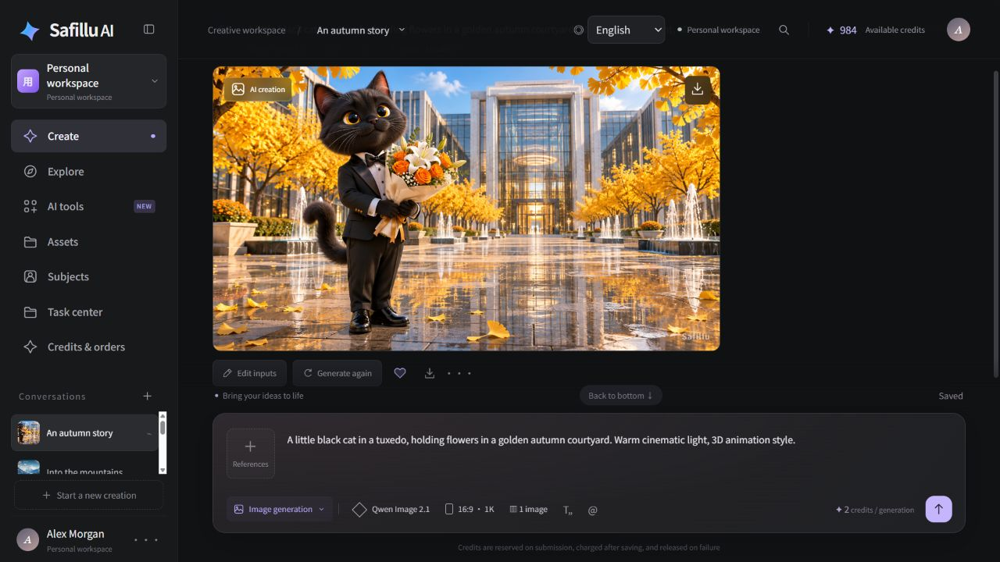
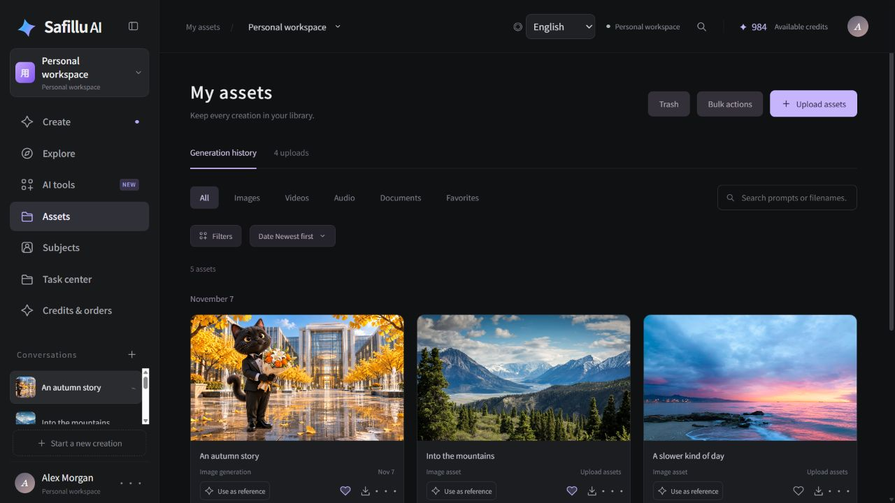
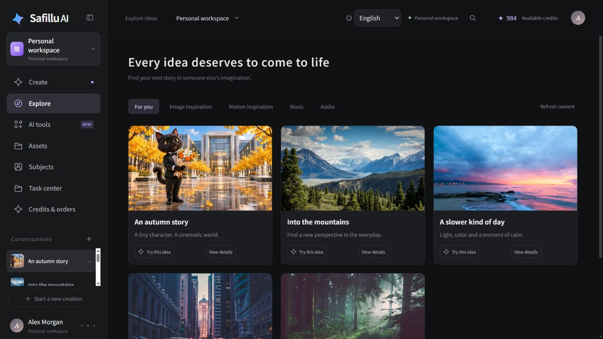
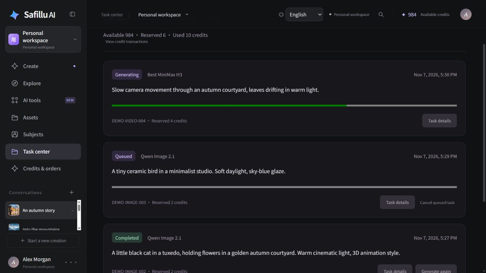

<div align="center">

# Safillu

### 让 AI 创作更开放、更易用。

在一个工作台里，创作视频、图片、语音和音乐。<br>
源码开放，自行部署，也能作为你自己的 AI 创作平台起点。

[English](README.md) · **简体中文** · [Español](README.es.md)

[](LICENSE)
[](#快速开始)
[](#配置与凭据)

[我们的愿景](#我们的愿景) · [功能清单](#功能清单) · [Roadmap](#roadmap规划中) · [开始部署](#快速开始) · [密钥申请与配置](docs/credentials.zh-CN.md) · [测试报告](docs/test-report.zh-CN.md) · [部署说明](docker/README.txt) · [提出想法](https://github.com/unrulpkk/safillu-aigc/issues)



</div>

**Safillu 是一个参考即梦 AI（Jimeng AI）创作流程的开源 AI 视频创作与图像生成平台，支持自行部署。** 从提示词开始，查看生成进度，带着原来的参数继续尝试，再把满意的结果留在自己的素材库里。

如果你想开发一款 **AI 创作 SaaS**，这里也准备好了生成之外的基础能力：账号、积分、管理后台、内容运营和 Docker 部署。

## 看看 Safillu 的界面

以下截图使用实际英文界面与整理后的演示内容。姓名、积分余额和任务状态均为展示示例；真实生成结果与验证情况请查看[测试报告](docs/test-report.zh-CN.md)。

| 留下每一次创作 | 发现下一个灵感 |
| --- | --- |
| [](docs/images/safillu-assets-en.jpg) | [](docs/images/safillu-explore-en.jpg) |
| **资产库**：上传、整理、收藏素材，并用于后续创作。 | **探索**：由管理后台发布精选内容，用户可复用提示词。 |

<details>
<summary><strong>任务中心：生成进度、历史记录与积分预占</strong></summary>



</details>

## 我们的愿景

我们以**技术平权、模型平权**为愿景，通过开源协作降低 AI 视频与图像创作的使用门槛，让创作者能够自主选择模型、部署服务，逐步构建自己的创作工作流。

## 从一个想法，到一份作品

| 你想创作什么 | 工作台能帮你做什么 |
| --- | --- |
| **AI 视频** | 提交视频生成任务、查看状态，并找回之前的创作记录。 |
| **AI 图片** | 文生图、使用模型支持的参考图与图片编辑能力，保存创作结果。 |
| **语音与音乐** | 在同一个工作台中使用语音和音乐模型。 |
| **自己的素材库** | 上传、预览、下载、收藏素材，并用于后续创作。 |
| **自己的 AI 平台** | 管理用户、角色、探索内容、积分和支付配置。 |

### 好的创作，往往不止生成一次

1. **写下想法。** 选择创作模式、模型和生成参数。
2. **等待作品。** 查看任务状态，保留每一次创作记录。
3. **换个方向。** 重新生成时回填原来的提示词和输入，改一改再试。
4. **留下成果。** 在资产库中找到作品，继续用于下一次创作。

### 给创作者一个工作台，给开发者一个起点

- **创作者：** 把提示词、生成记录和素材放在一起，方便继续打磨想法。
- **开发者：** 从已有的创作前端、Java 后端和芋道原生管理界面开始开发。
- **运营者：** 在同一套系统中发布探索内容、管理用户，服务创作站。
- **面向不同语言的用户：** 支持中文、英文和西班牙语切换。

## 功能清单

“已实现”表示应用已提供对应能力；真实生成、云存储、外部登录及收款还取决于相关凭据与服务商可用性。

| 模块 | 功能 | 状态 |
| --- | --- | --- |
| 账号 | 邮箱验证码与密码注册、邮箱密码登录（兼容原账号）、个人资料及密码修改、个人空间持久化 | 已实现；邮箱注册需配置 SMTP |
| Google 登录 | OAuth 回调、创建账号及登录 | 已实现，需配置 OAuth |
| 图片创作 | 通过支持的模型进行文生图、参考图编辑 | 已实现，需配置模型服务 |
| 视频创作 | 文字、图片输入；Best MiniMax H3 支持图片、音频、视频 URL 混合参考 | 已实现，需配置模型服务 |
| 语音与音乐 | 文本朗读、声音描述、语速设置、背景音乐生成 | 已实现，需配置模型服务 |
| 生成参数 | 模型选择及各模型支持的比例、分辨率、时长、生成数量 | 已实现，以模型限制为准 |
| 任务中心 | 持久化队列、状态及进度事件、历史、筛选、详情、分页、取消排队任务 | 已实现 |
| 重新生成 | 回填原提示词、模型、参数及参考素材，创建新的任务记录 | 已实现 |
| 对话与草稿 | 新建、重命名、置顶、删除对话，保存各创作模式草稿 | 已实现 |
| 资产管理 | 上传、图片与音视频预览、下载、搜索筛选、收藏、批量 ZIP 导出、回收站及恢复 | 已实现 |
| 媒体缓存 | 对话使用真实视频帧封面，按账号隔离的有界浏览器缓存，任务轮询保留播放进度 | 已实现 |
| 主体与编辑草稿 | 保存主体素材、通过 `@` 引用、保存编辑草稿 | 已实现，不代表已完成 AI 角色一致性 |
| 积分记账 | 报价、预占、归档成功结算、失败及取消释放、流水、重复请求保护 | 已实现 |
| Stripe 充值 | 积分套餐、托管 Checkout、订单、签名回调、退款及争议记账 | 已实现，需配置 Stripe 及套餐 |
| 存储 | 本地持久卷、公开 R2 优先、历史七牛兼容、归档后才完成任务 | 已实现，云存储需配置凭据 |
| 探索与运营 | 后台配置内容、发布下架、分类、创作同款；管理模型、空间、任务、资产、订单、套餐和流水 | 已实现 |
| 原生管理后台 | 芋道用户、角色、菜单、部门、字典、系统配置、日志和文件管理；管理员与运营权限 | 已实现 |
| 多语言与部署 | 前台及后台中、英、西班牙语；Docker 服务、初始化、健康检查、私有配置和增量迁移 | 已实现 |

数字人、动作迁移、音色试听/克隆及部分图片工具的完整生成链路仍未接通。微信支付状态见[密钥文档](docs/credentials.zh-CN.md#微信支付当前尚未接入本应用充值流程)；画布、角色一致性及 Agent 等后续工作列于下方规划。

## 开源模型接入与云端生成

Safillu 通过供应商 API 接入图片、视频、语音和音乐模型。当前注册表包含 **Qwen Image 2.1**、**Z-Image Base**、**Qwen Image 2.1 Edit**、**MiniMax H3 / SelfLift**、**Best MiniMax H3**、**Qwen3-TTS VoiceDesign** 和 **YuE2 BGM**。Best MiniMax H3 接受公开 URL 参考素材，最多支持 9 张图片、3 个音频和 3 个视频，可在已配置的分辨率档位生成 4–15 秒视频。

参考素材先上传到公开的 R2 存储。Best MiniMax H3 使用公开 URL 请求；Qwen 旧图片编辑接口保留其要求的 Base64 请求格式。

Best MiniMax H3 的公开 URL 流程已完成真实验证：R2 上传、模型生成、结果归档、保留原输入重新生成，以及积分结算。实测覆盖 4 秒、480P 视频。

平台同时容纳开放模型接入和云端生成服务。实际可用的模型及功能取决于供应商配置，各模型适用各自的许可证。Docker 编排部署的是应用服务，生成任务通过 API 执行；模型权重与本地 GPU 推理服务需另行准备。

## Roadmap（规划中）

以下方向均为后续开发规划。

| 方向 | 计划内容 |
| --- | --- |
| **开源模型本地部署** | 接入本地 GPU 推理服务，提供模型选择、部署与运行管理能力。 |
| **可视化画布** | 将提示词、素材、生成步骤与结果串联为可编辑的创作流程。 |
| **角色替换与一致性** | 在不同镜头中替换角色，保持外观与形象一致。 |
| **短剧制作 Agent** | 串联剧本、分镜、角色、配音与视频生成，辅助完成短剧制作。 |
| **热门视频趋势追踪** | 跟踪热门视频的题材、叙事结构与表现形式，帮助发现创作方向。 |
| **爆款创作流程复刻** | 拆解节奏、镜头和叙事结构，转化为可复用的创作模板。 |
| **科普视频制作** | 围绕知识主题，辅助组织讲解、分镜、配音与画面。 |

## 快速开始

安装 Docker Engine 和 Docker Compose v2.20 或以上版本。建议至少 4 核 CPU、8 GB 内存和 15 GB 可用磁盘；首次构建需要访问镜像与依赖仓库。宿主机无需安装 Java、Node.js、MySQL 或 Redis。

确保三个源码目录齐全，在本目录执行：

```bash
sh ./start.sh
```

脚本会依次构建镜像、生成私有凭据、初始化数据库，并等待服务健康。部署包含创作前端、管理前端、Java 21、MySQL 8.4、Redis 7 和初始化容器。

| 服务 | 默认地址 |
| --- | --- |
| 创作站 | http://localhost:8088 |
| 管理后台 | http://localhost:8089 |

默认数据库为 `safillu`。初始账号为 `admin`（管理员）和 `contentops`（内容运营），随机密码保存在 `.runtime/secrets/initial-accounts.json`，没有统一默认密码。在 Linux 上读取该文件可能需要 `sudo`。

如果端口已被占用，先复制 `.env.example` 为 `.env.local`，修改 `WEB_PORT`、`ADMIN_PORT` 和 `PUBLIC_ORIGIN`。

<details>
<summary><strong>部署细节：配置、架构与日常运维</strong></summary>

## 配置与凭据

技术基础为 **Java 21 · Spring Boot · ruoyi-vue-pro / 芋道 · Vue 管理端 · MySQL · Redis · Docker Compose**。创作站和管理端共用数据库、原生认证与权限体系。Google 登录和 Stripe 需要配置自己的账户。

各类密钥的申请入口、文件位置、启用及排查步骤统一放在独立的**[密钥申请与配置文档](docs/credentials.zh-CN.md)**，涵盖模型、R2、七牛、Google、Stripe、上游 RunPod、自动生成的密钥和微信支付接入状态。部署变量与目录结构保留在本 README。

| 文件或目录 | 用途 | 是否提交 Git |
| --- | --- | --- |
| `.env.example` | 不含密钥的本地部署模板 | 是 |
| `.env.prod.example` | 不含密钥的生产模板 | 是 |
| `.env.local` / `.env.prod.local` | 本机与生产环境的私有设置 | 否 |
| `.runtime/secrets/` | 数据库密码、加密密钥和第三方凭据 | 否 |
| `application-local.yaml` / `application-dev.yaml` | Java 私有开发配置 | 否 |

### `.env.example` 配置说明

首次安装时，使用下面任一命令创建私有配置；已有私有文件请直接编辑，不覆盖。启动脚本也会在目标文件不存在时自动复制对应模板。

```bash
# Linux / macOS
cp .env.example .env.local
```

```powershell
# Windows PowerShell
Copy-Item .env.example .env.local
```

根目录环境模板控制 Docker 部署，不是前端 `VITE_` 配置，也不填写 API Key 或密码。Compose 会读取选定的环境文件，但不会把这些变量自动导入当前 Shell。

| 参数 | 默认值 / 示例 | 如何配置 |
| --- | --- | --- |
| `COMPOSE_PROJECT_NAME` | `safillu` | 当前实例容器、网络、数据卷的命名前缀；独立部署另一个实例时使用不同名称。 |
| `DB_NAME` | `safillu` | 项目专用数据库名，初始化前确定。 |
| `DB_USERNAME` | `safillu_app` | 应用数据库账号，不使用 `root`；密码由安装器私下生成。 |
| `WEB_PORT` | `8088` | 创作站对宿主机开放的端口。 |
| `ADMIN_PORT` | `8089` | 芋道后台对宿主机开放的端口。 |
| `PUBLIC_ORIGIN` | `http://localhost:8088` | 浏览器实际访问的创作站源地址，含协议和非默认端口；生产填写 HTTPS 域名。Google 和 Stripe 返回地址使用它。 |
| `SAFILLU_RUNTIME_DIR` | `./.runtime` | 私有运行目录，其 `secrets/` 子目录挂载到容器内 `/run/secrets`。 |
| `GOOGLE_REDIRECT_URI` | 本地模板留空 | 启用 Google 时填写准确的授权回调。留空会使用 `http://localhost:8088/app-api/member/auth/google-login`，改变域名或端口后需同步修改。 |
| `QINIU_STORAGE_BOOTSTRAP` | `false` | 需要在启动时校验并选择已配置的七牛存储时设为 `true`。 |
| `R2_STORAGE_BOOTSTRAP` | `auto` | 自动优先使用已配置且验证通过的 R2；`false` 跳过 R2 启动校验，`true` 明确请求校验并启用。 |
| `STRIPE_MODE` | `TEST` | Stripe 密钥、数据环境，仅支持 `TEST` 或 `LIVE`，与 Java 的生产 Profile 分开。 |
| `STRIPE_LIVE_ENABLED` | `false` | 正式收款的额外开关；正式密钥、套餐、Webhook 准备并验证后才开启。 |
| `STRIPE_PUBLIC_WEBHOOK_URL` | 本地留空 | 配置 Stripe 后，公网回调为 `https://YOUR_CREATOR_DOMAIN/admin-api/aigc/payments/stripe/webhook`；本地 CLI 转发见密钥文档。 |
| `JAVA_OPTS` | `-Xms128m -Xmx768m` | 可选 JVM 参数；后端容器内存上限为 `1200m`，需给堆外内存留余量。 |

例如本地修改默认端口：

```dotenv
WEB_PORT=18088
ADMIN_PORT=18089
PUBLIC_ORIGIN=http://localhost:18088
GOOGLE_REDIRECT_URI=http://localhost:18088/app-api/member/auth/google-login
```

默认配置无需第三方凭据即可启动：使用本地存储，真实生成等待配置模型 Key，可选登录和支付等待各自凭据。启用 Google、Stripe 后，地址必须与相应服务中登记的地址一致。

生产环境复制 `.env.prod.example` 为 `.env.prod.local`，替换域名占位符，通过反向代理配置 HTTPS，然后执行：

```bash
sh ./start.sh .env.prod.local
```

Windows 使用 `.\start.ps1 -EnvFile .env.prod.local`。两份模板都刻意保持 Stripe 为 `TEST`；后续 Compose 命令使用同一份环境文件。重新运行启动脚本可应用部署参数变化；仅重启现有容器不会替换其环境变量。

已有实例不能通过修改项目名、数据库标识或运行目录来代替数据迁移。存储启动开关只负责校验、选择主存储，不迁移旧文件，关闭校验也不会自动替换已选主存储。`auto` 模式下，配置完整的 R2 优先于七牛；不要把两个存储开关同时明确设为 `true`。

模型、Google、Stripe 和存储的真实凭据只放在私有密钥文件中。不要写入前端 `VITE_` 变量、源码、README 或提交到 Git 的 YAML。只有经过检查且不含凭据的构建配置可以提交。`.gitignore` 无法清除已经进入提交历史的密钥。

Cloudflare R2 配置完整并通过上传、读取、删除校验后，会自动优先启用；配置缺失或校验失败时保留现有主存储。无云凭据的新安装使用本地上传持久卷。R2 模板见 [docker/storage-r2.example.json](docker/storage-r2.example.json)，历史文件继续保留原存储配置 ID。

密钥文件路径和启用命令见[部署及供应商配置说明](docker/README.txt)。

## 目录结构

```text
.
├── README.md / README.zh-CN.md / README.es.md  项目、部署和环境配置说明
├── .env.example / .env.prod.example          不含凭据的部署模板
├── .env.local / .env.prod.local              私有覆盖配置（Git 忽略）
├── compose.yaml                             完整服务编排
├── start.sh / start.ps1                      Linux/macOS 与 Windows 启动脚本
├── docs/
│   ├── credentials*.md                      中、英、西班牙语密钥文档
│   ├── test-report*.md                      中、英、西班牙语测试报告
│   ├── test-results.json                    脱敏验证结果快照
│   └── images/                              README 公共插图
├── docker/                                  镜像构建、初始化与验收脚本
├── lumina-studio/
│   ├── dist/                                创作前端源码与静态资源
│   ├── test/                                前端单元测试
│   └── server.cjs                           可选开发 / 静态服务器
├── zaomeng-admin/
│   ├── src/                                 芋道原生 Vue 管理端源码
│   └── public/                              后台公共资源
├── zaomeng-backend/
│   ├── server/
│   │   ├── yudao-server/                    Java 启动入口与环境配置
│   │   ├── yudao-module-aigc/               创作、任务、资产、积分和第三方接入
│   │   ├── yudao-module-system/             原生用户、角色与认证
│   │   ├── yudao-module-infra/              原生文件和基础设施服务
│   │   └── yudao-framework/                 公共框架组件
│   ├── database/mysql/                      数据库结构与增量迁移
│   ├── deploy/                              旧版部署材料和模板
│   └── scripts/                             维护与验收工具
└── .runtime/                                私有凭据、本地测试状态（Git 忽略）
```

`compose.yaml` 包含常驻的 `web`、`admin`、`backend`、`mysql`、`redis`，以及一次性的 `secrets-init`、`db-init`。两个网站代理到同一个后端；该编排不向宿主机公开 MySQL、Redis 和 Java 端口。

修改创作界面看 `lumina-studio/dist/`，后台界面看 `zaomeng-admin/src/`，业务逻辑看 `yudao-module-aigc/`，数据库改动追加新迁移。根目录 Compose 是全新安装入口；`zaomeng-backend/deploy/` 还保留旧部署材料，不能把两个初始化流程混用于已有数据库。

为兼容已有项目，保留历史目录名，产品名称统一为 Safillu。创作前端的 `dist/` 目前是应用源码输入，需要纳入版本管理；管理端生成的 `dist*` 目录会被忽略。

工作区可能保留已有的嵌套 Git 仓库。根目录 `.gitignore` 不会将它们转为普通目录；添加嵌套仓库可能只生成 Git 链接而非提交其源码。发布完整单仓库前，应明确保留或整合这些仓库的历史。

## 运维与验证

```bash
docker compose --env-file .env.local ps -a
docker compose --env-file .env.local logs --tail=100 backend db-init
docker compose --env-file .env.local down
```

普通停止操作会保留数据卷。备份应同时包含 MySQL 数据、上传卷及 `.runtime/secrets/`。`down -v` 会删除数据卷；丢失加密密钥可能导致历史文件无法读取。全新安装器拒绝接管没有 Safillu 迁移记录的既有数据库。

在隔离的 Linux 测试环境运行：

```bash
python docker/test_bootstrap.py
python docker/smoke-test.py .env.local http://127.0.0.1:8088 http://127.0.0.1:8089
python docker/validation/email-registration-test.py .env.local
```

验收脚本通过原生管理员创建用户，再创建对话和上传文件。邮箱注册测试使用真实 HTTP、MySQL、Redis 和本地 SMTP 接收器，要求项目名含 `qa` 或 `smoke` 且未配置发信账号，不向外部邮箱发送邮件。重启后再次执行可检查持久化。`docker/guard-test.py` 验证安装器拒绝行为，仅允许用于名称含 `smoke` 或 `qa` 的项目。R2 模拟测试随 Java 镜像构建执行。脱敏后的[测试报告](docs/test-report.zh-CN.md)纳入 `docs/`；原始日志、凭据及私人截图不提交 Git。

</details>

## 一起把它做成你的创作平台

**想做 AI 视频工具、图片生成工作台，或者自己的 AIGC SaaS？** 欢迎试用 Safillu，分享你的搭建方式，也告诉我们你最想完成的创作流程。

如果这个项目对你有帮助，欢迎 **点一颗 Star**，让更多创作者和开发者发现它。也欢迎通过 [Issues](https://github.com/unrulpkk/safillu-aigc/issues) 和 Pull Request 提交问题、可复现案例、模型适配器及翻译改进；示例中请移除密钥和个人信息。

## 许可证

Safillu 是参考即梦创作流程的独立项目，与即梦或字节跳动无隶属关系。应用源码采用 [MIT 许可证](LICENSE)，上游版权声明与模型许可证分别适用。
