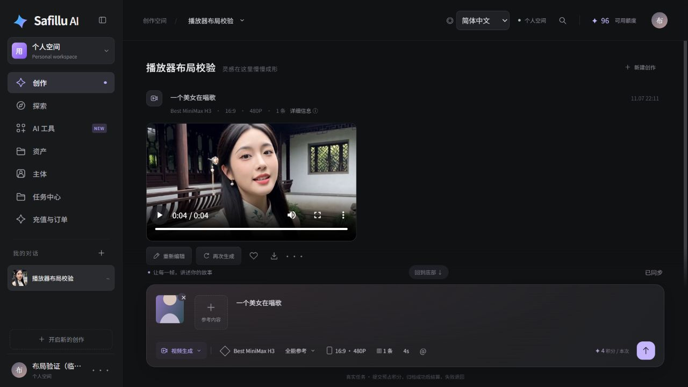

# Informe de pruebas de Safillu

[English](test-report.md) · [简体中文](test-report.zh-CN.md) · **Español** · [Volver al README](../README.es.md)

**Fecha: 2026-11-07 (Asia/Shanghai) · Versión del frontend: 20261107.4**

Las comprobaciones enumeradas se superaron, con los límites indicados más abajo. El informe distingue la ejecución automática actual, las integraciones reales registradas anteriormente y un entorno de navegador de solo lectura. No certifica todos los modelos, resoluciones o métodos de pago; no se calculó un porcentaje de cobertura de código. Los [resultados legibles por máquina](test-results.json) acompañan al informe. Se excluyen las credenciales y los registros privados.

## Resultados automáticos

| Conjunto | Resultado | Fecha / método |
| --- | --- | --- |
| Utilidades, orden de subida y caché de medios | 15 superadas, 0 fallidas | Ejecución Node actual; incluye 10 pruebas de caché |
| DOM del creador, idiomas, sondeo y miniaturas | 38 superadas, 0 fallidas | Ejecución JSDOM actual; estas pruebas no generan con un modelo real |
| Integración de contenido de Explorar | 4 superadas, 0 fallidas | Ejecución JSDOM actual |
| Backend Java 21 y almacenamiento | 32 superadas, 0 fallidas | Compilación Docker en Linux registrada el 7 de noviembre |
| Correo HTTP / MySQL / Redis / SMTP | 28 superadas, 0 fallidas | Linux aislado, 7 de noviembre; protocolos reales y receptor SMTP local |
| Inicialización del instalador | 4 superadas, 0 fallidas | Registro del 7 de noviembre |
| Administración nativa, permisos y persistencia tras reinicio | 17 superadas, 0 fallidas | Base Docker en Linux, 6 de noviembre |
| Protecciones de rechazo del instalador | 3 superadas, 0 fallidas | Linux aislado, 6 de noviembre |

Los conjuntos proceden de etapas distintas. No representan una única ejecución completa ni una cobertura del 100 %.

## Administrador, operador y creador

| Rol | Evidencia verificada | Límite |
| --- | --- | --- |
| Administrador | Roles y menús nativos de superadministrador, lista de usuarios y menús completos de plataforma; la creación de usuarios conserva las API de Yudao | No es una revisión de cada página de todos los módulos de Yudao |
| Operador de contenido | Rol aislado, acceso a gestión de Explorar y denegación del acceso a gestión de usuarios | Sin permisos de superadministrador; la edición y publicación completas requieren regresiones continuas con datos de negocio |
| Creador | Registro por código de correo, acceso por correo o usuario anterior, espacio personal, subida y persistencia; generación real, archivo de resultados, regeneración con datos originales y liquidación de créditos | Parte de la evidencia procede de pruebas reales anteriores; la revisión visual usa un entorno separado de solo lectura |

El creador y la administración comparten usuarios, tokens, permisos y la misma base de datos de Yudao.

## Integraciones y generación reales

- **Registro por correo:** los códigos caducan en 300 segundos, exigen 60 segundos entre envíos y se invalidan tras cinco errores o una validación correcta. Se probaron códigos inválidos/caducados, concurrencia, hash nativo de contraseñas, usuarios deshabilitados, fallos SMTP y bloqueo del registro antiguo sin verificación.
- **SMTP externo:** la cuenta configurada superó SSL y autenticación SMTP. El registro envió un código real aceptado por el servidor de correo. No se confirmó automáticamente su llegada a la bandeja de entrada. Las credenciales del remitente no se publican.
- **Best MiniMax H3:** las pruebas reales de Linux registradas cubren vídeos de 4 segundos y 480P. Las imágenes se suben a R2 antes de enviar sus URL públicas al modelo. Se verificaron referencias de imagen, referencias mixtas de imagen/audio/vídeo, archivo, historial y regeneración con texto, parámetros y referencias originales.
- **Créditos:** dos vídeos de prueba de 4 segundos y 480P liquidaron ocho puntos y dejaron cero puntos reservados. Cada tarea tuvo una reserva y una liquidación, sin duplicados. Los puntos de plataforma no prueban un pago con dinero real.
- **Almacenamiento y reproducción:** se verificaron subida, lectura pública y archivo en R2. Una solicitud de medios autenticada devolvió HTTP 206, `Content-Range` correcto y 65.536 bytes. El vídeo H.264/AAC probado dura aproximadamente 4,46 segundos y se decodifica correctamente.

## Correcciones y evidencia del navegador

| Problema | Corrección y evidencia |
| --- | --- |
| Reproductor pequeño dentro de un marco vacío | El vídeo ocupa el marco proporcional; las referencias tienen dimensiones fijas. El cuadro de entrada verificado mide unos 153px |
| La reproducción vuelve a 0:00 | El sondeo actualiza el área de tareas; los nuevos resultados conservan los reproductores existentes y su posición. El vídeo terminó pese al sondeo |
| Reproducir abre una ventana emergente | Los controles nativos no activan la vista previa; recargar renueva el acceso al medio sin generar ni cobrar puntos |
| Miniatura de conversación rota | Las URL MP4 ya no se usan como imágenes. Se extrae y almacena un fotograma real; el navegador verificó una portada de 640px y ninguna miniatura rota |
| Nueva descarga tras actualizar | IndexedDB separa cuentas y versiones. Tras actualizar se usa una URL Blob local; las solicitudes de medios del entorno de prueba permanecieron en tres |

La caché tiene un máximo de **64 MiB, 128 entradas y 14 días**, con **16 MiB por archivo**. Los archivos mayores siguen reproduciéndose progresivamente por red. Si el almacenamiento falla, se recurre a memoria o red; la caché no sustituye a los archivos del servidor. Las pruebas cubren deduplicación, aislamiento, versiones, caducidad, eliminación LRU, límites, archivos grandes, reintentos, fallos de almacenamiento y limpieza por cuenta.

La captura corresponde al entorno visual de solo lectura con un resultado generado real. El título, el usuario y la imagen de referencia son datos de prueba, no la cuenta real de un usuario.



## Límites y aspectos pendientes

- No se revisaron todas las interfaces de cada módulo de Yudao ni se calculó cobertura de código.
- No se generó realmente cada duración o resolución, ni la combinación máxima de 9 imágenes + 3 audios + 3 vídeos. Los límites tienen configuración y validación automática.
- Algunos canales antiguos de MiniMax, SelfLift y Qwen devolvieron HTTP 502 durante la prueba registrada; se registró la liberación de créditos de las tareas fallidas. La disponibilidad depende del proveedor.
- Esta ronda no ejecutó la autorización completa de Google en producción ni un pago real con Stripe. WeChat Pay no está integrado en la recarga de esta aplicación.
- Las rutas completas de avatares, imitación de movimiento y clonación de voz mantienen el estado del README. Las funciones previstas no se cuentan como superadas.
- La caché se verificó en Chromium de escritorio; no se completó toda la matriz de móviles y navegadores.

## Nombres planos de archivos multimedia — 2026-11-08

La compilación del backend en Linux superó **37 pruebas**, incluidas cinco sobre nombres planos, prevención de sobrescritura con nombres iguales, validación del contenido, carpetas habituales del framework y lectura de archivos históricos anidados. Se superaron **15 comprobaciones reales de HTTP, base de datos y R2** en la instalación aislada de GitHub.

Dos subidas con el mismo nombre original produjeron objetos distintos `AAAAMMDD_UUID.ext` en la raíz, conservando sus bytes y títulos de presentación. Los recursos de Explorar usan la misma estructura. Una generación real de cuatro segundos a 480P con Best MiniMax H3 aceptó una referencia en la raíz de R2 y guardó un MP4 cuya clave, título y nombre de descarga HTTP coincidían. Se liquidaron cuatro créditos sin reservas pendientes. Un vídeo histórico anidado conservó su ruta y los mismos bytes. Las fechas de las claves usan UTC; los archivos anteriores no se migran.

La comprobación usa solicitudes reales al modelo, HTTP, base de datos y almacenamiento; no añade una validación completa del navegador ni de pagos. Consulta los detalles en [test-results.json](test-results.json).

## Comprobación previa a la publicación en GitHub

La revisión abarcó 5.471 archivos seleccionados para publicar. Las reglas predeterminadas de Gitleaks 8.30.1 y la comparación con valores privados locales, incluidas sus formas codificadas, no detectaron filtraciones; la revisión de claves privadas DER incrustadas dio cero resultados. Se eliminaron credenciales fijas de ejemplo, datos personales de bucket/dominio y direcciones de red local. Los metadatos de repositorios anidados se respaldaron fuera de Git, sin importar su historial.

El código depurado superó la compilación del backend en Linux con 32 pruebas. El panel de administración se compiló para producción con las imágenes existentes de Node 22 / Nginx 1.28 fijadas por su digest. Se superaron 57 pruebas del frontend y nueve del instalador y de los límites de archivos públicos. Una actualización aislada de base de datos conservó los recuentos de usuarios, recursos y tareas y la configuración de almacenamiento. El flujo de GitHub revisa el historial y rechaza archivos privados y enlaces a repositorios anidados. Los resultados corresponden a esta instantánea; los cambios futuros también deben revisarse.

## Reproducir las pruebas

Desde el repositorio de código:

```bash
npm --prefix lumina-studio run check
npm --prefix lumina-studio test
npm --prefix zaomeng-backend/qa ci
node --test zaomeng-backend/qa/frontend.test.cjs zaomeng-backend/qa/explore.test.cjs
python docker/test_bootstrap.py
```

Las pruebas Java se ejecutan en Linux con `docker compose --env-file .env.local build backend`. Ejecuta las pruebas de correo únicamente en una instalación aislada, con `qa` o `smoke` en el nombre del proyecto y sin cuenta SMTP configurada:

```bash
python docker/validation/email-registration-test.py .env.local
```

La generación real consume cuota del proveedor y créditos de plataforma. Configura modelos, SMTP y almacenamiento según la [guía de credenciales](credentials.es.md) antes de repetirla. El informe público contiene solo resultados depurados; contraseñas, tokens, credenciales de almacenamiento, solicitudes completas y registros privados permanecen fuera de Git.
