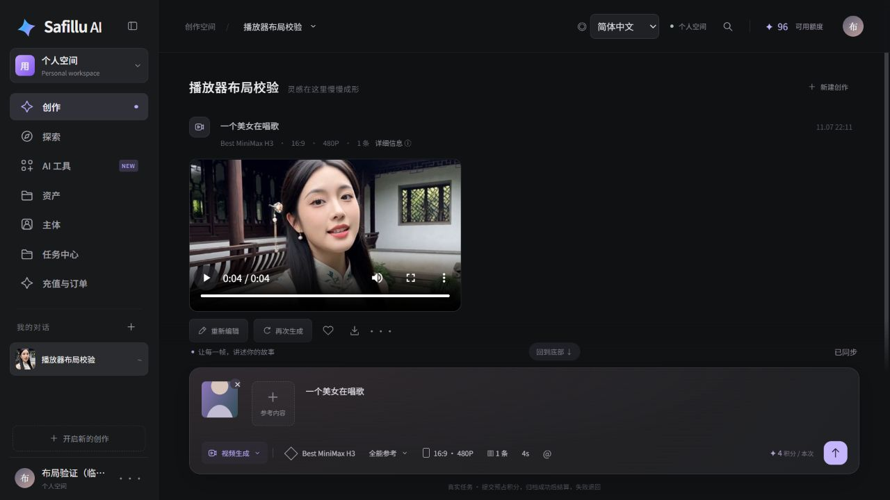

# Safillu test report

**English** · [简体中文](test-report.zh-CN.md) · [Español](test-report.es.md) · [Back to README](../README.md)

**Report date: 2026-11-07 (Asia/Shanghai) · Frontend asset version: 20261107.4**

The checks listed here passed, subject to the limits below. This report distinguishes the current automated run, previously recorded live integration tests, and a read-only browser fixture. It does not certify every model, resolution, or payment method; a code coverage percentage was not collected. [Machine-readable results](test-results.json) are versioned alongside this report. Credentials and private logs are excluded.

## Automated results

| Suite | Result | Date / method |
| --- | --- | --- |
| Creator helpers, upload ordering, media cache | 15 passed, 0 failed | Current Node run; includes 10 cache tests |
| Creator DOM, languages, polling, thumbnails | 38 passed, 0 failed | Current JSDOM run; these DOM tests do not generate with a real model |
| Explore content integration | 4 passed, 0 failed | Current JSDOM run |
| Java 21 backend and storage | 32 passed, 0 failed | Recorded Linux Docker build, November 7 |
| Email HTTP / MySQL / Redis / SMTP | 28 passed, 0 failed | Recorded isolated Linux run, November 7; real protocols and a local SMTP sink |
| Installer bootstrap | 4 passed, 0 failed | Recorded November 7 |
| Native admin, operator permissions, restart persistence | 17 passed, 0 failed | Recorded Linux Docker baseline, November 6 |
| Installer refusal guards | 3 passed, 0 failed | Recorded isolated Linux run, November 6 |

These suites come from different execution stages. They are not presented as one full run or as 100% coverage.

## Administrator, operator, and creator

| Role | Verified evidence | Boundary |
| --- | --- | --- |
| Administrator | Native super-admin roles and menus, user listing, complete platform menu seed; user creation continues to use native Yudao APIs | Not a page-by-page regression of every Yudao module |
| Content operator | Isolated operator role, access to exploration management, denial of user management access | No super-admin privileges; full editing/publishing workflows need continuing regression with business data |
| Creator | Email-code registration, email/password and legacy username login, personal workspace, upload and persistence; real generation, asset archival, regeneration with original input, and credit settlement | Some evidence is from earlier live runs; browser layout checks use a separate read-only fixture |

The creator and admin continue to share Yudao users, tokens, permissions, and the same database.

## Live integrations and generation

- **Email registration:** codes expire after 300 seconds, have a 60-second resend cooldown, and are invalidated after five incorrect attempts or one successful validation. Isolated tests cover invalid/expired codes, concurrent registration, native password hashing, disabled users, SMTP failure reporting, and blocking the old unverified signup endpoint.
- **External SMTP:** the configured sender passed SSL and SMTP authentication. The registration endpoint sent a real verification message accepted by the mail server. Inbox receipt was not automatically confirmed. Sender credentials are not published.
- **Best MiniMax H3:** recorded live Linux runs cover 4-second, 480P outputs. Reference images upload to R2 before public URLs are sent to the model. Cases include image references, mixed image/audio/video references, archival, task history, and regeneration preserving the original prompt, settings, and references.
- **Credits:** two recorded 4-second, 480P videos settled for eight points, with zero points left reserved. Each task had one reservation and one settlement, without duplicate settlement. Platform points are not evidence of a real payment transaction.
- **Storage and playback:** R2 upload, public reads, and archival passed. An authenticated media request returned HTTP 206 with the correct `Content-Range` and 65,536 bytes. The tested H.264/AAC video is about 4.46 seconds long and decodes successfully.

## Fixes and browser evidence

| Issue | Fix and evidence |
| --- | --- |
| Small player in a large empty frame | Video fills its aspect-ratio frame; references have fixed bounds. The verified composer is about 153px high |
| Playback resets to 0:00 | Polling updates the task area; inserting new results preserves existing player nodes and playback positions. The video played to completion across a polling interval |
| Play controls open a modal | Native media controls bypass the preview click delegation; reload refreshes media access without submitting generation or charging points |
| Broken conversation thumbnail | MP4 URLs are no longer used as images. A real decoded frame is cached; browser checks show a 640px poster and zero broken sidebar images |
| Repeated video downloads after refresh | IndexedDB keys isolate accounts and asset versions. After refresh, playback uses a local Blob URL; fixture media requests stayed at three before and after reload |

The cache is bounded to **64 MiB, 128 entries, and 14 days**, with a **16 MiB per-file limit**. Larger files retain progressive network playback. Unavailable or full storage falls back to memory or network; cached files do not replace server assets. Tests cover deduplication, account/version isolation, expiry, LRU eviction, entry limits, oversized files, retries, storage failures, and account-specific clearing.

This screenshot is from the read-only layout fixture using a real generated result. Its title, user, and reference image are test data, not a real user's account screenshot.



## Limits and unverified areas

- No complete UI regression of every Yudao business module and no code coverage percentage.
- Not every duration/resolution was generated live. The maximum 9-image + 3-audio + 3-video input was not generated live; limits have configuration and automated validation.
- Some legacy MiniMax, SelfLift, and Qwen channels returned HTTP 502 in the recorded run; failed-task credit releases were recorded. Availability depends on provider configuration.
- This round did not execute complete production Google consent or live Stripe payment. WeChat Pay is not connected to this application's top-up flow.
- Full digital-human, motion-imitation, and voice-cloning paths retain the status documented in the README. Planned features are not counted as passed.
- Actual browser cache verification used desktop Chromium; the full mobile/browser matrix has not been tested.

## GitHub publication preflight

The preflight covered 5,471 files selected for publication. Gitleaks 8.30.1 default rules and matching against locally known private values, including encoded forms, found no leaks; the embedded DER private-key check found zero. Fixed credential examples, personal bucket/domain settings, and LAN defaults were removed. Nested repository metadata was backed up outside Git, and its history is not imported.

The cleaned source passed a Linux backend build with 32 tests. The admin production build passed using the existing Node 22 / Nginx 1.28 image digests. Frontend tests passed all 57 cases; installer and public-file boundary tests passed all nine. An isolated database upgrade preserved user, asset, and task counts and the existing storage configuration. The GitHub workflow scans committed history and rejects private runtime files and embedded repository links. These findings apply to this source snapshot; future changes still require review.

## Reproduce

From the source repository:

```bash
npm --prefix lumina-studio run check
npm --prefix lumina-studio test
npm --prefix zaomeng-backend/qa ci
node --test zaomeng-backend/qa/frontend.test.cjs zaomeng-backend/qa/explore.test.cjs
python docker/test_bootstrap.py
```

Java tests run inside `docker compose --env-file .env.local build backend` on Linux. Run email tests only in a dedicated isolated installation whose project name contains `qa` or `smoke`, with no SMTP account configured:

```bash
python docker/validation/email-registration-test.py .env.local
```

Live generation consumes provider quota and platform credits. Configure models, SMTP, and storage using the [credential guide](credentials.md) before a live retest. This public report contains sanitized results only; passwords, tokens, object credentials, raw requests, and private logs stay in Git-ignored locations.
