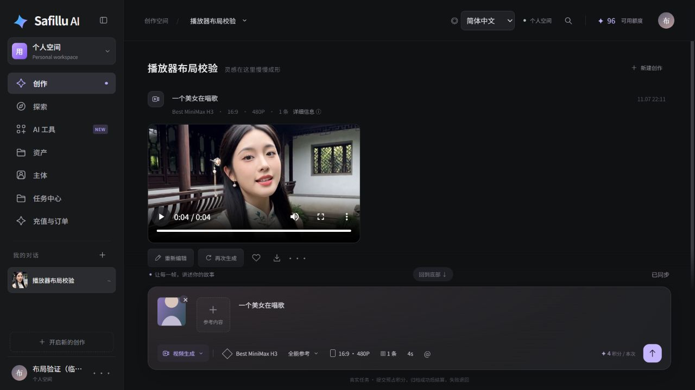

# Safillu 测试报告

[English](test-report.md) · **简体中文** · [Español](test-report.es.md) · [返回 README](../README.zh-CN.md)

**报告日期：2026-11-07（Asia/Shanghai） · 前端版本：20261107.4**

结论：本文列明的测试通过，仍有下文所列的验证边界。本报告区分本次执行、此前已记录的真实联调、浏览器只读验证环境，不代表所有模型、分辨率、支付方式均已验证，也没有统计代码覆盖率百分比。[机器可读结果](test-results.json)与本报告一同保存在仓库；原始凭据和私人日志不随报告发布。

## 自动化结果

| 测试集 | 结果 | 记录日期 / 方式 |
| --- | --- | --- |
| 创作工具、上传顺序、媒体缓存 | 15 通过，0 失败 | 本次 Node 测试；含 10 项缓存测试 |
| 用户端 DOM、多语言、任务轮询、缩略图 | 38 通过，0 失败 | 本次 JSDOM 测试；DOM 测试本身不进行真实模型生成 |
| 探索内容对接 | 4 通过，0 失败 | 本次 JSDOM 测试 |
| Java 21 后端与存储 | 32 通过，0 失败 | 11 月 7 日 Linux Docker 构建记录 |
| 邮箱注册 HTTP / MySQL / Redis / SMTP | 28 通过，0 失败 | 11 月 7 日 Linux 隔离环境，真实协议、本地 SMTP 接收器 |
| 安装器初始化 | 4 通过，0 失败 | 11 月 7 日记录 |
| 原生管理端、运营权限、重启持久化基线 | 17 通过，0 失败 | 11 月 6 日 Linux Docker 记录 |
| 安装器拒绝保护 | 3 通过，0 失败 | 11 月 6 日 Linux 隔离环境记录 |

以上测试集来自不同执行阶段，不合并为一次全量运行或“100% 覆盖率”。

## 管理员、运营与用户

| 角色 | 已有验证 | 边界 |
| --- | --- | --- |
| 管理员 | 原生超级管理员角色与菜单、用户列表、平台租户完整菜单种子；创建用户的接口继续使用芋道原生能力 | 这不是所有芋道模块逐页面、逐按钮的完整回归 |
| 内容运营 | 运营角色隔离、可读取探索内容管理、访问用户管理被拒绝 | 不授予超级管理员权限；完整发布编辑流程需要结合业务数据持续回归 |
| 用户 | 邮箱验证码注册、邮箱密码登录、原账号登录兼容、个人空间、上传和重启后数据保留；模型生成、资产归档、原输入重新生成和积分结算 | 部分证据来自此前真实联调，当前浏览器布局测试使用单独的只读验证页面 |

用户端与管理端继续复用同一套芋道用户、令牌、权限和数据库。

## 真实接口与模型联调

- **邮箱注册**：验证码 300 秒过期，60 秒重发间隔，连续 5 次输错失效，一次成功校验即销毁。隔离环境验证了无效/过期验证码、并发防重复注册、原生密码哈希、被禁用用户拒绝登录、SMTP 失败不报告成功，以及旧的无邮箱验证码注册入口被拒绝。
- **实际发信**：已配置发信账号通过 SSL 和 SMTP 登录验证；注册接口真实发送验证码，邮件服务器接受投递。未自动确认用户收件箱送达。SMTP 凭据未写入公开报告。
- **Best MiniMax H3**：此前真实 Linux 联调覆盖 4 秒、480P 视频；参考图先上传 R2，再传公开 URL。测试包含图片参考及图片/音频/视频混合参考、结果归档、任务记录和保留原提示词、参数、参考素材的重新生成。
- **积分**：记录中的两条 4 秒、480P 测试视频共结算 8 积分，剩余预占为 0；每个任务各有一次预占与一次结算，没有重复结算。这里是平台积分，不能视为支付实付验收。
- **存储与播放**：R2 上传、公开读取、结果归档已验证；认证媒体接口实际返回 HTTP 206 和正确的 `Content-Range`，读取的分段为 65,536 字节。测试视频为 H.264/AAC，约 4.46 秒，可正常解码。

## 本次修复与浏览器验证

| 问题 | 修复与证据 |
| --- | --- |
| 视频缩在卡片左上角 | 视频填满比例框，参考图有固定尺寸；验证画面中输入区约 153px |
| 播放反复回到 0:00 | 任务轮询只更新任务区域；新作品插入保留已有播放器 DOM 和进度。浏览器中视频跨过轮询周期并完整播放结束 |
| 点击播放误开弹窗 | 原生音视频控件不再触发作品预览代理事件；重载只刷新媒体读取，不提交生成或扣费 |
| 对话列表出现破图 | 不再将 MP4 当成图片。解码后提取真实帧，缓存封面；浏览器验证封面宽 640px，破损缩略图数量为 0 |
| 刷新后重复读取视频 | IndexedDB 按账号和素材版本隔离；浏览器刷新后播放器使用本地 Blob URL，验证服务的媒体请求数从 3 保持为 3，没有新增媒体请求 |

缓存默认上限 **64 MiB / 128 条 / 14 天**，单个文件上限 **16 MiB**。更大文件继续分段网络播放。缓存拒写、存储不可用等情况回退到内存或网络；缓存不替代服务端资产。自动测试覆盖并发去重、账号隔离、版本变化、过期、LRU 淘汰、条目上限、大文件跳过、失败重试、存储失败和按账号清理。

下图来自只读布局验证页面，媒体使用真实生成结果；标题、用户和参考图为验证数据，不是用户真实账号的截图。



## 待验证与已知边界

- 不是所有芋道业务模块的完整界面回归，也没有代码覆盖率统计。
- 尚未逐一真实生成所有时长、分辨率，未执行满额 9 图 + 3 音频 + 3 视频参考的生成；这些上限有配置和自动校验。
- 历史联调中部分旧 MiniMax、SelfLift、Qwen 渠道返回 HTTP 502；失败任务的积分释放已记录。渠道能否使用取决于供应商配置。
- 本次未执行 Google 线上完整授权、Stripe 正式付款；微信支付尚未接入本应用充值流程。
- 数字人、动作模仿、音色克隆等完整模型链路仍按 README 标注；本报告不把规划功能列为通过。
- 浏览器缓存实际验证使用桌面 Chromium；未完成所有移动端和浏览器组合的回归。

## GitHub 发布前检查

本次发布前检查覆盖 5,471 个待提交文件。Gitleaks 8.30.1 默认规则扫描与本机已知私有值（含编码形式）的匹配检查均未发现泄露；内嵌 DER 私钥检查为 0。已清理旧示例中的固定凭据、个人桶/域名和内网默认地址，并将旧仓库元数据备份到 Git 忽略目录，不将其历史带入本仓库。

清理后的源码在 Linux 完成后端构建及 32 项测试；管理端使用已有的 Node 22 / Nginx 1.28 镜像摘要完成生产构建。前端 57 项测试、安装器与公开文件边界共 9 项测试通过。隔离数据库升级验证保留了用户、资产、任务数量及原存储配置。GitHub 工作流会继续扫描提交历史并拒绝私有运行文件和内嵌仓库链接。扫描结果针对本次源码快照，不代表未来修改无需复查。

## 复现

源码仓库中运行：

```bash
npm --prefix lumina-studio run check
npm --prefix lumina-studio test
npm --prefix zaomeng-backend/qa ci
node --test zaomeng-backend/qa/frontend.test.cjs zaomeng-backend/qa/explore.test.cjs
python docker/test_bootstrap.py
```

Linux 的 Java 测试随 `docker compose --env-file .env.local build backend` 执行。只有在专用、名称包含 `qa` 或 `smoke`、未配置发信账号的隔离实例运行邮箱测试：

```bash
python docker/validation/email-registration-test.py .env.local
```

真实模型复测会调用供应商并消耗模型额度和平台积分，需先按[密钥文档](credentials.zh-CN.md)配置模型、SMTP 和存储。公开报告仅收录脱敏结果；账号密码、令牌、对象密钥、原始请求和私人日志保留在 Git 忽略目录中。
